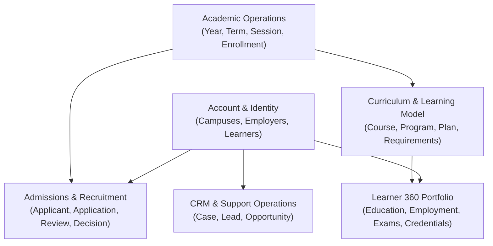

# SUNY Common Dev — Salesforce Object Schema & Architecture Overview

**Target Org**: `SUNY_COMMON_DEV` | **Platform**: Salesforce Education Cloud & CRM | **Metadata Root**: [`force-app/main/default/objects/`](file:///d:/SUNY_COMMON_DEV/SUNY_COMMON_DEV/force-app/main/default/objects/)

The SUNY Common Dev schema serves as the enterprise data backbone across 64 SUNY campuses. Built on **Salesforce Education Cloud**, it standardizes constituent identity, recruitment & admissions, academic operations, curriculum catalogs, learner portfolios, and student support. Detailed field-level specifications, ERDs, and SOQL queries for all 35 entities reside in individual files within [`docs/objects/`](file:///d:/SUNY_COMMON_DEV/SUNY_COMMON_DEV/docs/objects/).

---

## 1. High-Level Architecture & Domain Map

---

## 2. Core Functional Domains & Entity Index

Detailed per-object documentation is modularized in [`docs/objects/`](file:///d:/SUNY_COMMON_DEV/SUNY_COMMON_DEV/docs/objects/):

| Domain | Core Objects & Documentation Links | Architecture & SUNY Role |
| :--- | :--- | :--- |
| **Identity & Access** | [Account](file:///d:/SUNY_COMMON_DEV/SUNY_COMMON_DEV/docs/objects/Account.md) · [Contact](file:///d:/SUNY_COMMON_DEV/SUNY_COMMON_DEV/docs/objects/Contact.md) · [User](file:///d:/SUNY_COMMON_DEV/SUNY_COMMON_DEV/docs/objects/User.md) · [PersonAccount](file:///d:/SUNY_COMMON_DEV/SUNY_COMMON_DEV/docs/objects/PersonAccount.md) | Models SUNY campuses (`Campus`), partner employers (`Employer`), staff/faculty (`Contact`/`User`), and unified learner profiles (`PersonAccount`). |
| **Admissions & Recruitment** | [Applicant](file:///d:/SUNY_COMMON_DEV/SUNY_COMMON_DEV/docs/objects/Applicant.md) · [IndividualApplication](file:///d:/SUNY_COMMON_DEV/SUNY_COMMON_DEV/docs/objects/IndividualApplication.md) · [ProgramTermApplnTimeline](file:///d:/SUNY_COMMON_DEV/SUNY_COMMON_DEV/docs/objects/ProgramTermApplnTimeline.md) · [ApplicationReview](file:///d:/SUNY_COMMON_DEV/SUNY_COMMON_DEV/docs/objects/ApplicationReview.md) · [ApplicationDecision](file:///d:/SUNY_COMMON_DEV/SUNY_COMMON_DEV/docs/objects/ApplicationDecision.md) · [ApplicationRecommendation](file:///d:/SUNY_COMMON_DEV/SUNY_COMMON_DEV/docs/objects/ApplicationRecommendation.md) | End-to-end recruitment lifecycle from prospect intake windows to multi-tiered faculty reviews, recommendations, and formal decision offers. |
| **Academic Operations** | [AcademicYear](file:///d:/SUNY_COMMON_DEV/SUNY_COMMON_DEV/docs/objects/AcademicYear.md) · [AcademicTerm](file:///d:/SUNY_COMMON_DEV/SUNY_COMMON_DEV/docs/objects/AcademicTerm.md) · [AcademicSession](file:///d:/SUNY_COMMON_DEV/SUNY_COMMON_DEV/docs/objects/AcademicSession.md) · [AcademicTermEnrollment](file:///d:/SUNY_COMMON_DEV/SUNY_COMMON_DEV/docs/objects/AcademicTermEnrollment.md) · [AcademicCredential](file:///d:/SUNY_COMMON_DEV/SUNY_COMMON_DEV/docs/objects/AcademicCredential.md) | Institutional calendar hierarchy (years, semesters, modular sessions), student term enrollment/GPA tracking, and degree taxonomy definitions. |
| **Curriculum & Learning** | [Learning](file:///d:/SUNY_COMMON_DEV/SUNY_COMMON_DEV/docs/objects/Learning.md) · [LearningCourse](file:///d:/SUNY_COMMON_DEV/SUNY_COMMON_DEV/docs/objects/LearningCourse.md) · [LearningProgram](file:///d:/SUNY_COMMON_DEV/SUNY_COMMON_DEV/docs/objects/LearningProgram.md) · [LearningProgramPlan](file:///d:/SUNY_COMMON_DEV/SUNY_COMMON_DEV/docs/objects/LearningProgramPlan.md) · [LearningProgramPlanRqmt](file:///d:/SUNY_COMMON_DEV/SUNY_COMMON_DEV/docs/objects/LearningProgramPlanRqmt.md) · [LearningAchievement](file:///d:/SUNY_COMMON_DEV/SUNY_COMMON_DEV/docs/objects/LearningAchievement.md) · [LearningPathwayTemplate](file:///d:/SUNY_COMMON_DEV/SUNY_COMMON_DEV/docs/objects/LearningPathwayTemplate.md) · [LearningPathwayTemplateItem](file:///d:/SUNY_COMMON_DEV/SUNY_COMMON_DEV/docs/objects/LearningPathwayTemplateItem.md) · [LearningEquivalency](file:///d:/SUNY_COMMON_DEV/SUNY_COMMON_DEV/docs/objects/LearningEquivalency.md) · [LearningEquivalencyLearning](file:///d:/SUNY_COMMON_DEV/SUNY_COMMON_DEV/docs/objects/LearningEquivalencyLearning.md) | Course catalogs, academic majors/minors, versioned catalog plans, graduation requirement rules, roadmap templates, and statewide transfer credit articulations. |
| **Learner 360 History** | [PersonEducation](file:///d:/SUNY_COMMON_DEV/SUNY_COMMON_DEV/docs/objects/PersonEducation.md) · [PersonEmployment](file:///d:/SUNY_COMMON_DEV/SUNY_COMMON_DEV/docs/objects/PersonEmployment.md) · [PersonExamination](file:///d:/SUNY_COMMON_DEV/SUNY_COMMON_DEV/docs/objects/PersonExamination.md) · [PersonLanguage](file:///d:/SUNY_COMMON_DEV/SUNY_COMMON_DEV/docs/objects/PersonLanguage.md) · [PersonAcademicCredential](file:///d:/SUNY_COMMON_DEV/SUNY_COMMON_DEV/docs/objects/PersonAcademicCredential.md) · [PersonDisability](file:///d:/SUNY_COMMON_DEV/SUNY_COMMON_DEV/docs/objects/PersonDisability.md) | Longitudinal constituent profiles capturing prior schooling, transcripts, test scores, employment/internships, language proficiencies, and accommodations. |
| **Support & Operational** | [Case](file:///d:/SUNY_COMMON_DEV/SUNY_COMMON_DEV/docs/objects/Case.md) · [Lead](file:///d:/SUNY_COMMON_DEV/SUNY_COMMON_DEV/docs/objects/Lead.md) · [Opportunity](file:///d:/SUNY_COMMON_DEV/SUNY_COMMON_DEV/docs/objects/Opportunity.md) · [In_App_Checklist_Settings__c](file:///d:/SUNY_COMMON_DEV/SUNY_COMMON_DEV/docs/objects/In_App_Checklist_Settings__c.md) | Advising tickets and student services inquiries, prospective student leads, corporate partnerships/grants, and onboarding checklist metadata. |

---

## 3. Key Architectural Patterns

1. **Person Account Unification**: Enrolled students and applicants exist as `PersonAccount` records, unifying Account and Contact into a singular entity for holistic Learner 360 tracking.
2. **Abstract Learning Polymorphism**: The `Learning` object acts as the abstract catalog root, specialized into discrete courses (`LearningCourse`) and degree programs (`LearningProgram`).
3. **Decoupled Curriculum Roadmaps**: Academic requirements (`LearningProgramPlanRqmt`) decouple graduation logic from courses, enabling multi-catalog versioning (`LearningProgramPlan`) and transfer equivalencies (`LearningEquivalency`).
4. **Admissions-to-Enrollment Pipeline**: Prospective students convert from `Lead` to `Applicant` and `IndividualApplication`, move through `ApplicationReview` and `ApplicationDecision`, and matriculate into `AcademicTermEnrollment`.

---

## 4. End-to-End System Journeys

- **Admissions-to-Enrollment**: Prospect inquiry ([Lead](file:///d:/SUNY_COMMON_DEV/SUNY_COMMON_DEV/docs/objects/Lead.md)) converts to applicant identity ([PersonAccount](file:///d:/SUNY_COMMON_DEV/SUNY_COMMON_DEV/docs/objects/PersonAccount.md)), submits application ([IndividualApplication](file:///d:/SUNY_COMMON_DEV/SUNY_COMMON_DEV/docs/objects/IndividualApplication.md)) during intake window ([ProgramTermApplnTimeline](file:///d:/SUNY_COMMON_DEV/SUNY_COMMON_DEV/docs/objects/ProgramTermApplnTimeline.md)), undergoes faculty scoring ([ApplicationReview](file:///d:/SUNY_COMMON_DEV/SUNY_COMMON_DEV/docs/objects/ApplicationReview.md)), receives offer ([ApplicationDecision](file:///d:/SUNY_COMMON_DEV/SUNY_COMMON_DEV/docs/objects/ApplicationDecision.md)), and enrolls ([AcademicTermEnrollment](file:///d:/SUNY_COMMON_DEV/SUNY_COMMON_DEV/docs/objects/AcademicTermEnrollment.md)).
- **Transfer Articulation & Degree Audit**: External transcripts ([PersonEducation](file:///d:/SUNY_COMMON_DEV/SUNY_COMMON_DEV/docs/objects/PersonEducation.md)) evaluate against articulation rules ([LearningEquivalency](file:///d:/SUNY_COMMON_DEV/SUNY_COMMON_DEV/docs/objects/LearningEquivalency.md)), granting SUNY course credits ([LearningCourse](file:///d:/SUNY_COMMON_DEV/SUNY_COMMON_DEV/docs/objects/LearningCourse.md)) to fulfill graduation rules ([LearningProgramPlanRqmt](file:///d:/SUNY_COMMON_DEV/SUNY_COMMON_DEV/docs/objects/LearningProgramPlanRqmt.md)) toward degree conferral ([PersonAcademicCredential](file:///d:/SUNY_COMMON_DEV/SUNY_COMMON_DEV/docs/objects/PersonAcademicCredential.md)).

---

## 5. Development & Deployment Reference

- **Source Metadata**: Stored in [`force-app/main/default/objects/`](file:///d:/SUNY_COMMON_DEV/SUNY_COMMON_DEV/force-app/main/default/objects/) for version control and CI/CD.
- **Manifest**: Deployed and retrieved via Salesforce DX using [`manifest/package.xml`](file:///d:/SUNY_COMMON_DEV/SUNY_COMMON_DEV/manifest/package.xml).
- **Per-Object Documentation**: All individual entity schemas are maintained in [`docs/objects/`](file:///d:/SUNY_COMMON_DEV/SUNY_COMMON_DEV/docs/objects/) (strictly 50–100 lines each).

---

[Return to Project Overview](file:///d:/SUNY_COMMON_DEV/SUNY_COMMON_DEV/docs/project_overview.md) | [Browse Object Schemas Directory](file:///d:/SUNY_COMMON_DEV/SUNY_COMMON_DEV/docs/objects/)
