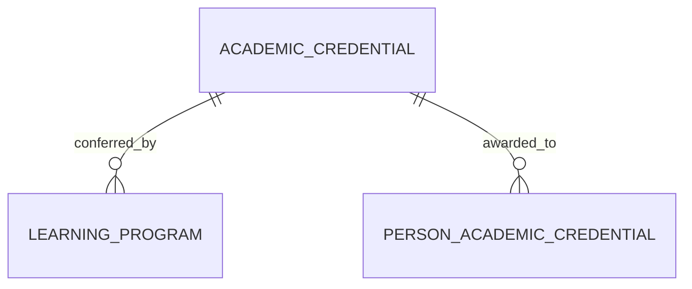

# Academic Credential (AcademicCredential)

**Object Type**: Standard Education Cloud Object  
**Key Prefix**: `0AC`  
**Module / Cloud**: Academic Operations & Calendar  
**Metadata Definition**: [force-app/main/default/objects/AcademicCredential/](file:///d:/SUNY_COMMON_DEV/SUNY_COMMON_DEV/force-app/main/default/objects/AcademicCredential/)

---

## 1. Overview & Role in SUNY

Defines credential types awarded across SUNY institutions, including Bachelor degrees, Associate degrees, Master's, Doctoral degrees, and certificates.

---

## 2. Record Types & Classification

- Degree: Formal undergraduate or graduate academic diplomas.
- Certificate: Post-secondary or professional certificate credentials.

---

## 3. Key Fields Specification

| Field Label | API Name | Data Type | Reference / Target | Description |
| :--- | :--- | :--- | :--- | :--- |
| **Name** | `Name` | Text(255) | - | Credential title (e.g. Bachelor of Science, Associate in Applied Science). |
| **CredentialType** | `CredentialType` | Picklist | - | Classification (Degree, Diploma, Certificate, Badge). |
| **Level** | `Level` | Picklist | - | Academic level (Undergraduate, Graduate, Professional, Continuing Ed). |
| **Status** | `Status` | Picklist | - | Operational status (Active, Inactive, Discontinued). |
| **Description** | `Description` | Text(255) | - | Description of academic requirements and governance. |

---

## 4. Entity Relationships & Data Flow



### Outbound Relationships (Parent References)
- None (Macro credential taxonomy catalog entity)

### Inbound Relationships (Child Records)
- LearningProgram.AcademicCredentialId -> Degree programs culminating in this credential
- PersonAcademicCredential.AcademicCredentialId -> Student conferral records for this credential

---

## 5. Sample SOQL Query

```sql
SELECT Id, Name, CredentialType, Level, Status FROM AcademicCredential ORDER BY Name LIMIT 10
```

---

[Return to Master Object Schema Overview](file:///d:/SUNY_COMMON_DEV/SUNY_COMMON_DEV/docs/object_schema.md)
