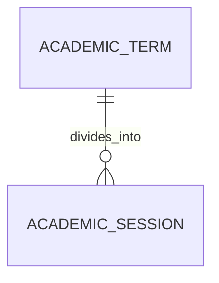

# Academic Session (AcademicSession)

**Object Type**: Standard Education Cloud Object  
**Key Prefix**: `0AS`  
**Module / Cloud**: Academic Operations & Calendar  
**Metadata Definition**: [force-app/main/default/objects/AcademicSession/](file:///d:/SUNY_COMMON_DEV/SUNY_COMMON_DEV/force-app/main/default/objects/AcademicSession/)

---

## 1. Overview & Role in SUNY

Represents modular instruction blocks or mini-sessions within an Academic Term (e.g., 7-week accelerated session, Summer Session I, Winter Intersession).

---

## 2. Record Types & Classification

- Standard Session: Mini-sessions and accelerated modular scheduling windows.

---

## 3. Key Fields Specification

| Field Label | API Name | Data Type | Reference / Target | Description |
| :--- | :--- | :--- | :--- | :--- |
| **Name** | `Name` | Text(255) | - | Session title (e.g. Fall 2026 - Accelerated Term A). |
| **AcademicTermId** | `AcademicTermId` | Lookup | AcademicTerm | Parent semester containing this instructional session. |
| **SessionType** | `SessionType` | Picklist | - | Classification (Accelerated, Weekend, Evening, Intensive). |
| **StartDate** | `StartDate` | Date | - | First day of instruction for this specific session. |
| **EndDate** | `EndDate` | Date | - | Last day of classes and finals for this session. |
| **Description** | `Description` | Text(255) | - | Administrative notes explaining session scheduling format. |

---

## 4. Entity Relationships & Data Flow



### Outbound Relationships (Parent References)
- AcademicTermId -> [AcademicTerm](file:///d:/SUNY_COMMON_DEV/SUNY_COMMON_DEV/docs/objects/AcademicTerm.md) (Parent semester)

### Inbound Relationships (Child Records)
- CourseOffering.AcademicSessionId -> Specific class sections scheduled within this session window

---

## 5. Sample SOQL Query

```sql
SELECT Id, Name, AcademicTerm.Name, SessionType, StartDate, EndDate FROM AcademicSession LIMIT 10
```

---

[Return to Master Object Schema Overview](file:///d:/SUNY_COMMON_DEV/SUNY_COMMON_DEV/docs/object_schema.md)
