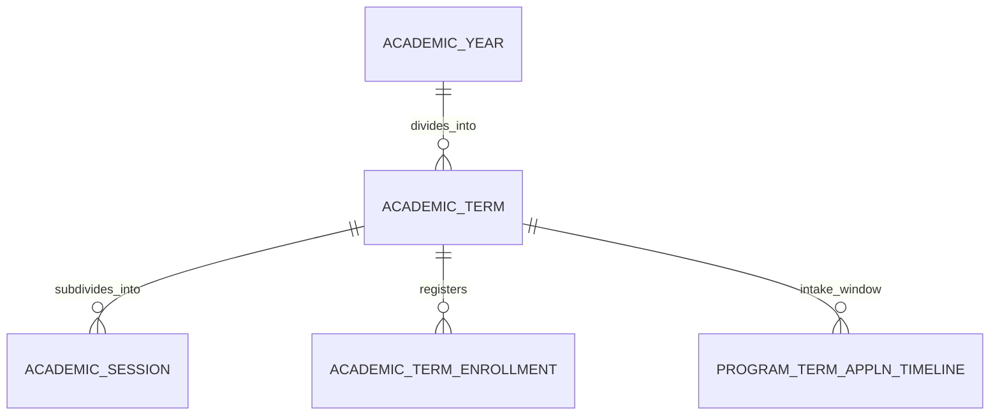

# Academic Term (AcademicTerm)

**Object Type**: Standard Education Cloud Object  
**Key Prefix**: `0AT`  
**Module / Cloud**: Academic Operations & Calendar  
**Metadata Definition**: [force-app/main/default/objects/AcademicTerm/](file:///d:/SUNY_COMMON_DEV/SUNY_COMMON_DEV/force-app/main/default/objects/AcademicTerm/)

---

## 1. Overview & Role in SUNY

Defines specific academic semesters or trimesters (e.g., Fall 2026, Spring 2027) within an Academic Year for class registration, billing, and grading.

---

## 2. Record Types & Classification

- Semester: Standard 15-week fall and spring instructional terms.
- Quarter / Trimester: Accelerated calendar terms and summer sessions.

---

## 3. Key Fields Specification

| Field Label | API Name | Data Type | Reference / Target | Description |
| :--- | :--- | :--- | :--- | :--- |
| **Name** | `Name` | Text(255) | - | Name of the term (e.g., Fall 2026 Semester). |
| **AcademicYearId** | `AcademicYearId` | Lookup | AcademicYear | Parent academic year encompassing this term. |
| **TermType** | `TermType` | Picklist | - | Classification of term (Fall, Spring, Summer, Winter). |
| **StartDate** | `StartDate` | Date | - | First instructional day of the academic semester. |
| **EndDate** | `EndDate` | Date | - | Final examination and grading closure date. |
| **RegistrationStartDate** | `RegistrationStartDate` | Date | - | Date when course enrollment registration opens for students. |
| **CensusDate** | `CensusDate` | Date | - | Official campus enrollment snapshot date for reporting. |

---

## 4. Entity Relationships & Data Flow



### Outbound Relationships (Parent References)
- AcademicYearId -> [AcademicYear](file:///d:/SUNY_COMMON_DEV/SUNY_COMMON_DEV/docs/objects/AcademicYear.md) (Parent annual cycle)

### Inbound Relationships (Child Records)
- AcademicSession.AcademicTermId -> Sub-sessions and modular course scheduling blocks
- AcademicTermEnrollment.AcademicTermId -> Student term enrollments and registration units
- ProgramTermApplnTimeline.AcademicTermId -> Admissions intake windows open for this term

---

## 5. Sample SOQL Query

```sql
SELECT Id, Name, AcademicYear.Name, TermType, StartDate, EndDate FROM AcademicTerm ORDER BY StartDate DESC LIMIT 10
```

---

[Return to Master Object Schema Overview](file:///d:/SUNY_COMMON_DEV/SUNY_COMMON_DEV/docs/object_schema.md)
