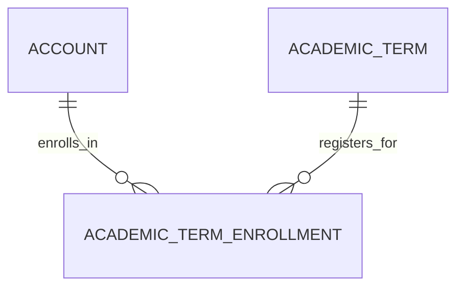

# Academic Term Enrollment (AcademicTermEnrollment)

**Object Type**: Standard Education Cloud Object  
**Key Prefix**: `0TE`  
**Module / Cloud**: Academic Operations & Calendar  
**Metadata Definition**: [force-app/main/default/objects/AcademicTermEnrollment/](file:///d:/SUNY_COMMON_DEV/SUNY_COMMON_DEV/force-app/main/default/objects/AcademicTermEnrollment/)

---

## 1. Overview & Role in SUNY

Records a student's term-level academic standing, registered credits, GPA, and active enrollment status in an Academic Term across SUNY campuses.

---

## 2. Record Types & Classification

- Full-Time: Enrolled in 12 or more credit hours per semester.
- Part-Time: Enrolled in fewer than 12 credit hours per semester.

---

## 3. Key Fields Specification

| Field Label | API Name | Data Type | Reference / Target | Description |
| :--- | :--- | :--- | :--- | :--- |
| **Name** | `Name` | Text(255) | - | Enrollment record identifier label. |
| **AccountId** | `AccountId` | Lookup | Account | Student Person Account registered for the term. |
| **AcademicTermId** | `AcademicTermId` | Lookup | AcademicTerm | Specific semester for which enrollment is active. |
| **EnrollmentStatus** | `EnrollmentStatus` | Picklist | - | Status (Enrolled, Withdrawn, Leave of Absence, Graduated). |
| **EnrolledCredits** | `EnrolledCredits` | Number(4,2) | - | Total registered credit hours for the academic term. |
| **TermGpa** | `TermGpa` | Number(3,2) | - | Grade point average earned exclusively within this semester. |
| **CumulativeGpa** | `CumulativeGpa` | Number(3,2) | - | Overall cumulative GPA across all completed coursework. |

---

## 4. Entity Relationships & Data Flow



### Outbound Relationships (Parent References)
- AccountId -> [Account](file:///d:/SUNY_COMMON_DEV/SUNY_COMMON_DEV/docs/objects/Account.md) (Learner Person Account)
- AcademicTermId -> [AcademicTerm](file:///d:/SUNY_COMMON_DEV/SUNY_COMMON_DEV/docs/objects/AcademicTerm.md) (Enrolled semester)

### Inbound Relationships (Child Records)
- AcademicStanding -> Satisfactory academic progress evaluation for financial aid and advising

---

## 5. Sample SOQL Query

```sql
SELECT Id, Name, Account.Name, AcademicTerm.Name, EnrollmentStatus, EnrolledCredits, TermGpa FROM AcademicTermEnrollment LIMIT 10
```

---

[Return to Master Object Schema Overview](file:///d:/SUNY_COMMON_DEV/SUNY_COMMON_DEV/docs/object_schema.md)
