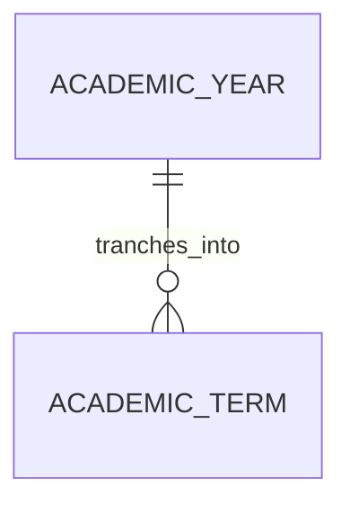

# Academic Year (AcademicYear)

**Object Type**: Standard Education Cloud Object  
**Key Prefix**: `0AY`  
**Module / Cloud**: Academic Operations & Calendar  
**Metadata Definition**: [force-app/main/default/objects/AcademicYear/](file:///d:/SUNY_COMMON_DEV/SUNY_COMMON_DEV/force-app/main/default/objects/AcademicYear/)

---

## 1. Overview & Role in SUNY

Highest-level institutional calendar unit spanning an entire SUNY academic cycle (e.g., 2026-2027 Academic Year). Sets the macro boundary for terms and financial aid years.

---

## 2. Record Types & Classification

- Standard Academic Year: Represents annual calendar periods across all SUNY campuses.

---

## 3. Key Fields Specification

| Field Label | API Name | Data Type | Reference / Target | Description |
| :--- | :--- | :--- | :--- | :--- |
| **Name** | `Name` | Text(255) | - | Label of the academic year (e.g. 2026-2027 Academic Year). |
| **StartDate** | `StartDate` | Date | - | First day of the academic calendar year (typically August/September). |
| **EndDate** | `EndDate` | Date | - | Final day of the academic calendar year (typically May/June). |
| **IsActive** | `IsActive` | Checkbox | - | Indicates whether this academic year is active for scheduling and operations. |
| **Description** | `Description` | Text(255) | - | Optional administrative notes regarding this academic cycle. |

---

## 4. Entity Relationships & Data Flow



### Outbound Relationships (Parent References)
- None (Top-level academic calendar hierarchy entity)

### Inbound Relationships (Child Records)
- AcademicTerm.AcademicYearId -> Tranches into Fall, Winter, Spring, Summer semesters

---

## 5. Sample SOQL Query

```sql
SELECT Id, Name, StartDate, EndDate, IsActive FROM AcademicYear ORDER BY StartDate DESC LIMIT 10
```

---

[Return to Master Object Schema Overview](file:///d:/SUNY_COMMON_DEV/SUNY_COMMON_DEV/docs/object_schema.md)
