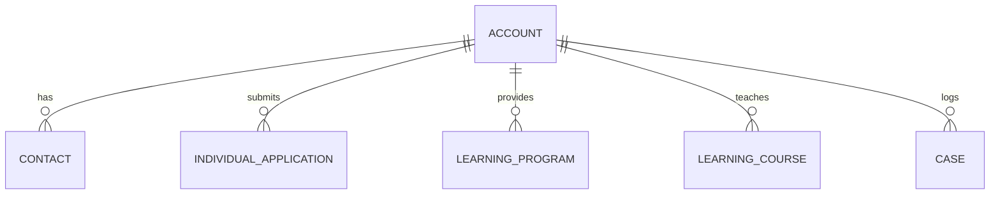

# Account (Account)

**Object Type**: Standard Object  
**Key Prefix**: `001`  
**Module / Cloud**: Institutional & Identity Model  
**Metadata Definition**: [force-app/main/default/objects/Account/](file:///d:/SUNY_COMMON_DEV/SUNY_COMMON_DEV/force-app/main/default/objects/Account/)

---

## 1. Overview & Role in SUNY

The Account object is the core pillar of the SUNY Common Dev ecosystem. In this multi-campus architecture, Account represents institutional entities (SUNY Campuses), external corporate partners (Employers), and individual learners (Person Accounts).

---

## 2. Record Types & Classification

- Campus (Account.Campus): Represents individual SUNY colleges and university centers (e.g., Stony Brook, Buffalo, Albany, Binghamton).
- Employer (Account.Employer): Corporate and non-profit partner employers providing internships, cooperative education, and career placement.
- Person Account (Account.PersonAccount): Represents enrolled students and prospective learners by unifying Account and Contact into a single record.

---

## 3. Key Fields Specification

| Field Label | API Name | Data Type | Reference / Target | Description |
| :--- | :--- | :--- | :--- | :--- |
| **Name** | `Name` | Text(255) | - | Official name of the Campus, Employer company, or Learner. |
| **RecordTypeId** | `RecordTypeId` | Lookup | RecordType | Distinguishes between Campus, Employer, and Person Account records. |
| **ParentId** | `ParentId` | Lookup | Account | Institutional hierarchy link (e.g. SUNY System Administration -> Specific Campus). |
| **PersonEmail** | `PersonEmail` | Email | - | Personal primary email address for Person Accounts (Learners). |
| **PersonBirthdate** | `PersonBirthdate` | Date | - | Student date of birth for identity verification and eligibility. |
| **PersonMailingAddress** | `PersonMailingAddress` | Address | - | Official student residential and mailing address. |
| **Industry** | `Industry` | Picklist | - | Sector categorization for employer and institutional accounts. |
| **Ownership** | `Ownership` | Picklist | - | Ownership structure (e.g., Public for SUNY institutions, Private for employers). |

---

## 4. Entity Relationships & Data Flow



### Outbound Relationships (Parent References)
- ParentId -> [Account](file:///d:/SUNY_COMMON_DEV/SUNY_COMMON_DEV/docs/objects/Account.md) (Higher-level system or institutional parent)

### Inbound Relationships (Child Records)
- Contact.AccountId -> Campus faculty, advisors, and student contacts
- IndividualApplication.AccountId -> Applications submitted by learners
- LearningProgram.ProviderId -> Academic degree programs offered by the campus
- LearningCourse.ProviderId -> Course offerings taught by the campus
- PersonEducation.InstitutionAccountId -> Prior colleges or high schools attended
- Case.AccountId -> Advising tickets and student support inquiries

---

## 5. Sample SOQL Query

```sql
SELECT Id, Name, RecordType.DeveloperName, ParentId, PersonEmail FROM Account ORDER BY Name LIMIT 10
```

---

[Return to Master Object Schema Overview](file:///d:/SUNY_COMMON_DEV/SUNY_COMMON_DEV/docs/object_schema.md)
