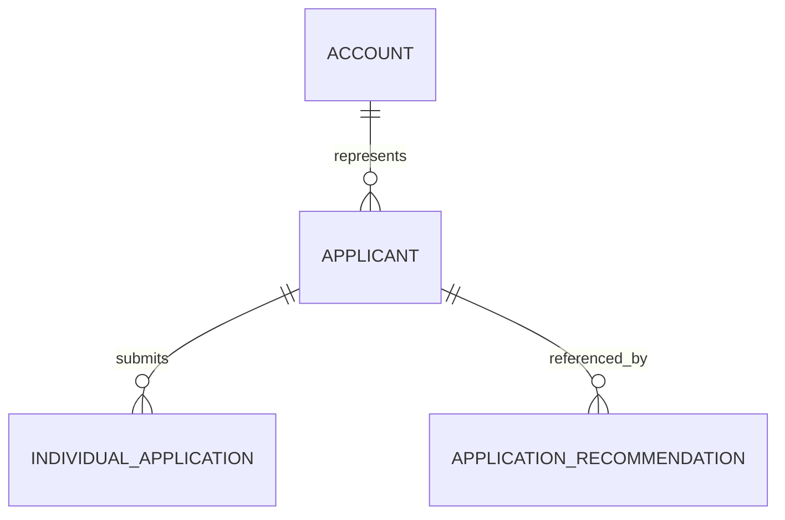

# Applicant (Applicant)

**Object Type**: Standard Education Cloud Object  
**Key Prefix**: `14D`  
**Module / Cloud**: Admissions & Recruitment  
**Metadata Definition**: [force-app/main/default/objects/Applicant/](file:///d:/SUNY_COMMON_DEV/SUNY_COMMON_DEV/force-app/main/default/objects/Applicant/)

---

## 1. Overview & Role in SUNY

Represents a prospective candidate who is seeking admission into a SUNY college, university center, or degree program prior to formal enrollment.

---

## 2. Record Types & Classification

- Standard Applicant: Represents domestic and international applicant candidate profiles.

---

## 3. Key Fields Specification

| Field Label | API Name | Data Type | Reference / Target | Description |
| :--- | :--- | :--- | :--- | :--- |
| **Name** | `Name` | Text(255) | - | Applicant identifier or full name label. |
| **AccountId** | `AccountId` | Lookup | Account | Associated Person Account record for this candidate. |
| **ContactId** | `ContactId` | Lookup | Contact | Associated Contact record for this candidate. |
| **Stage** | `Stage` | Picklist | - | Recruitment lifecycle stage (Inquiry, Prospect, Applicant, Admitted, Enrolled). |
| **Status** | `Status` | Picklist | - | Operational status of the applicant candidate record. |
| **FirstTermOfEnrollmentId** | `FirstTermOfEnrollmentId` | Lookup | AcademicTerm | Anticipated initial academic term of enrollment. |

---

## 4. Entity Relationships & Data Flow



### Outbound Relationships (Parent References)
- AccountId -> [Account](file:///d:/SUNY_COMMON_DEV/SUNY_COMMON_DEV/docs/objects/Account.md) (Learner constituent account)
- ContactId -> [Contact](file:///d:/SUNY_COMMON_DEV/SUNY_COMMON_DEV/docs/objects/Contact.md) (Applicant contact record)
- FirstTermOfEnrollmentId -> [AcademicTerm](file:///d:/SUNY_COMMON_DEV/SUNY_COMMON_DEV/docs/objects/AcademicTerm.md) (Target intake term)

### Inbound Relationships (Child Records)
- IndividualApplication.ApplicantId -> Formal application submissions created by this applicant
- ApplicationRecommendation.ApplicantId -> Letters of recommendation linked to this candidate

---

## 5. Sample SOQL Query

```sql
SELECT Id, Name, Stage, Status, Account.Name FROM Applicant ORDER BY Name LIMIT 10
```

---

[Return to Master Object Schema Overview](file:///d:/SUNY_COMMON_DEV/SUNY_COMMON_DEV/docs/object_schema.md)
