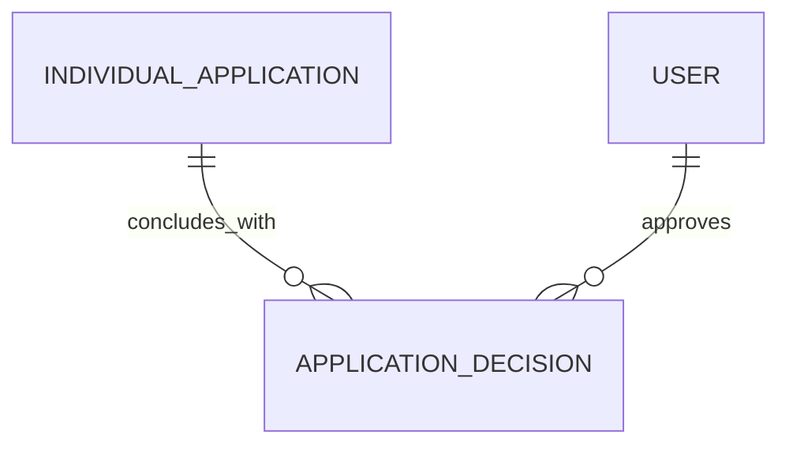

# Application Decision (ApplicationDecision)

**Object Type**: Standard Education Cloud Object  
**Key Prefix**: `14E`  
**Module / Cloud**: Admissions & Recruitment  
**Metadata Definition**: [force-app/main/default/objects/ApplicationDecision/](file:///d:/SUNY_COMMON_DEV/SUNY_COMMON_DEV/force-app/main/default/objects/ApplicationDecision/)

---

## 1. Overview & Role in SUNY

Stores formal institutional admissions decisions (Accept, Waitlist, Deny, Conditional Offer) rendered for an individual application.

---

## 2. Record Types & Classification

- Standard Decision: Official institutional decision outcomes rendered by admissions committees.

---

## 3. Key Fields Specification

| Field Label | API Name | Data Type | Reference / Target | Description |
| :--- | :--- | :--- | :--- | :--- |
| **Name** | `Name` | Text(255) | - | Decision record identifier or letter code. |
| **ApplicationId** | `ApplicationId` | Lookup | IndividualApplication | Associated application evaluated for admission. |
| **DecisionStatus** | `DecisionStatus` | Picklist | - | Formal decision outcome (Accepted, Denied, Waitlisted, Conditional). |
| **DecisionDate** | `DecisionDate` | Date | - | Date on which the official decision was rendered. |
| **Reason** | `Reason` | Text(255) | - | Admissions rationale or specific criteria explanation. |
| **DecisionRenderedById** | `DecisionRenderedById` | Lookup | User | Admissions dean or officer approving the decision. |

---

## 4. Entity Relationships & Data Flow



### Outbound Relationships (Parent References)
- ApplicationId -> [IndividualApplication](file:///d:/SUNY_COMMON_DEV/SUNY_COMMON_DEV/docs/objects/IndividualApplication.md) (Evaluated application)
- DecisionRenderedById -> [User](file:///d:/SUNY_COMMON_DEV/SUNY_COMMON_DEV/docs/objects/User.md) (Approving admissions officer)

### Inbound Relationships (Child Records)
- Case.ApplicationDecisionId -> Inquiries regarding admission decision letters and appeal workflows

---

## 5. Sample SOQL Query

```sql
SELECT Id, Name, Application.Name, DecisionStatus, DecisionDate, Reason FROM ApplicationDecision LIMIT 10
```

---

[Return to Master Object Schema Overview](file:///d:/SUNY_COMMON_DEV/SUNY_COMMON_DEV/docs/object_schema.md)
