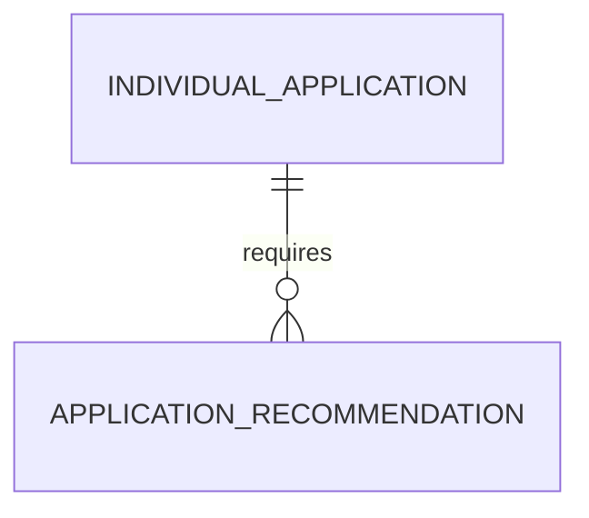

# Application Recommendation (ApplicationRecommendation)

**Object Type**: Standard Education Cloud Object  
**Key Prefix**: `14M`  
**Module / Cloud**: Admissions & Recruitment  
**Metadata Definition**: [force-app/main/default/objects/ApplicationRecommendation/](file:///d:/SUNY_COMMON_DEV/SUNY_COMMON_DEV/force-app/main/default/objects/ApplicationRecommendation/)

---

## 1. Overview & Role in SUNY

Tracks letters of recommendation, recommender requests, evaluator evaluations, and submission verification for admissions candidates.

---

## 2. Record Types & Classification

- Academic Reference: High school counselor or college faculty recommendation.
- Professional Reference: Employer or internship supervisor recommendation.

---

## 3. Key Fields Specification

| Field Label | API Name | Data Type | Reference / Target | Description |
| :--- | :--- | :--- | :--- | :--- |
| **Name** | `Name` | Text(255) | - | Recommendation tracking reference identifier. |
| **ApplicationId** | `ApplicationId` | Lookup | IndividualApplication | Target application requiring the recommendation letter. |
| **RecommenderName** | `RecommenderName` | Text(128) | - | Full name of the recommender submitting feedback. |
| **RecommenderEmail** | `RecommenderEmail` | Email | - | Email address used to send the secure recommendation submission portal link. |
| **Status** | `Status` | Picklist | - | Workflow state (Requested, Sent, Received, Waived). |
| **RecommendationText** | `RecommendationText` | LongTextArea | - | Confidential narrative recommendation text. |

---

## 4. Entity Relationships & Data Flow



### Outbound Relationships (Parent References)
- ApplicationId -> [IndividualApplication](file:///d:/SUNY_COMMON_DEV/SUNY_COMMON_DEV/docs/objects/IndividualApplication.md) (Target application)

### Inbound Relationships (Child Records)
- ApplicationReview -> Provides supporting qualitative evidence during candidate scoring

---

## 5. Sample SOQL Query

```sql
SELECT Id, Name, Application.Name, RecommenderName, RecommenderEmail, Status FROM ApplicationRecommendation LIMIT 10
```

---

[Return to Master Object Schema Overview](file:///d:/SUNY_COMMON_DEV/SUNY_COMMON_DEV/docs/object_schema.md)
