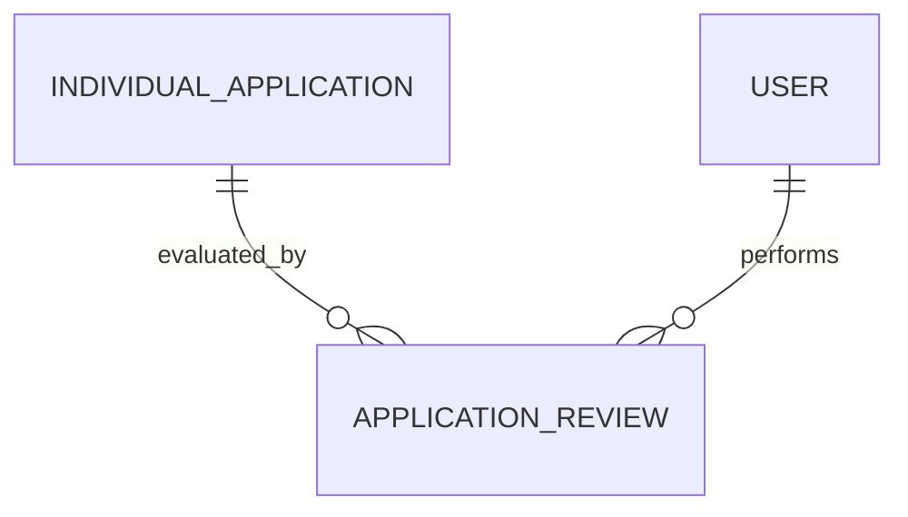

# Application Review (ApplicationReview)

**Object Type**: Standard Education Cloud Object  
**Key Prefix**: `14R`  
**Module / Cloud**: Admissions & Recruitment  
**Metadata Definition**: [force-app/main/default/objects/ApplicationReview/](file:///d:/SUNY_COMMON_DEV/SUNY_COMMON_DEV/force-app/main/default/objects/ApplicationReview/)

---

## 1. Overview & Role in SUNY

Captures admissions evaluation scoring, faculty feedback rubrics, and committee recommendations for an applicant's dossier.

---

## 2. Record Types & Classification

- Faculty Review: Academic department evaluation of portfolio or prerequisites.
- Admissions Officer Review: Holistic review of academic transcripts and essays.

---

## 3. Key Fields Specification

| Field Label | API Name | Data Type | Reference / Target | Description |
| :--- | :--- | :--- | :--- | :--- |
| **Name** | `Name` | Text(255) | - | Review assessment identifier or rubric code. |
| **ApplicationId** | `ApplicationId` | Lookup | IndividualApplication | Application evaluated by the reviewer. |
| **ReviewerId** | `ReviewerId` | Lookup | User | Faculty or staff member completing the evaluation. |
| **ReviewStatus** | `ReviewStatus` | Picklist | - | Status of review (Assigned, In Progress, Completed). |
| **Score** | `Score` | Number(5,2) | - | Numerical holistic or rubric rating assigned to candidate. |
| **Recommendation** | `Recommendation` | Picklist | - | Reviewer recommendation (Admit, Deny, Waitlist, Interview). |
| **Comments** | `Comments` | LongTextArea | - | Detailed evaluator feedback notes and committee commentary. |

---

## 4. Entity Relationships & Data Flow



### Outbound Relationships (Parent References)
- ApplicationId -> [IndividualApplication](file:///d:/SUNY_COMMON_DEV/SUNY_COMMON_DEV/docs/objects/IndividualApplication.md) (Evaluated application)
- ReviewerId -> [User](file:///d:/SUNY_COMMON_DEV/SUNY_COMMON_DEV/docs/objects/User.md) (Assigned evaluator)

### Inbound Relationships (Child Records)
- ApplicationDecision -> Consolidates review ratings to formulate final admission offer

---

## 5. Sample SOQL Query

```sql
SELECT Id, Name, Application.Name, Reviewer.Name, ReviewStatus, Score, Recommendation FROM ApplicationReview LIMIT 10
```

---

[Return to Master Object Schema Overview](file:///d:/SUNY_COMMON_DEV/SUNY_COMMON_DEV/docs/object_schema.md)
