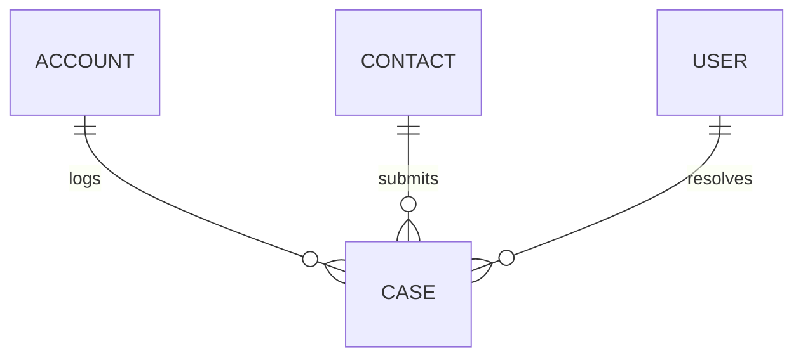

# Case (Case)

**Object Type**: Standard Object  
**Key Prefix**: `500`  
**Module / Cloud**: Core CRM & Support Operations  
**Metadata Definition**: [force-app/main/default/objects/Case/](file:///d:/SUNY_COMMON_DEV/SUNY_COMMON_DEV/force-app/main/default/objects/Case/)

---

## 1. Overview & Role in SUNY

Manages student inquiries, admissions questions, financial aid appeals, IT help tickets, and academic advising appointment logs.

---

## 2. Record Types & Classification

- Admissions Inquiry: Questions regarding application status and requirements.
- Academic Advising: Degree audit and course scheduling advising requests.
- Financial Aid: Tuition billing, FAFSA, and scholarship appeal tickets.

---

## 3. Key Fields Specification

| Field Label | API Name | Data Type | Reference / Target | Description |
| :--- | :--- | :--- | :--- | :--- |
| **CaseNumber** | `CaseNumber` | Text(30) | - | System-generated unique sequential ticket tracking number. |
| **Subject** | `Subject` | Text(255) | - | Summary description of student support inquiry. |
| **Status** | `Status` | Picklist | - | Case resolution status (New, In Progress, Waiting on Student, Closed). |
| **Priority** | `Priority` | Picklist | - | Urgency rating (Low, Medium, High, Urgent). |
| **AccountId** | `AccountId` | Lookup | Account | Associated student or institutional Account. |
| **ContactId** | `ContactId` | Lookup | Contact | Associated student contact record. |
| **Origin** | `Origin` | Picklist | - | Intake channel (Web Portal, Email, Phone, In-Person). |
| **Description** | `Description` | LongTextArea | - | Comprehensive details of inquiry and staff resolution notes. |

---

## 4. Entity Relationships & Data Flow



### Outbound Relationships (Parent References)
- AccountId -> [Account](file:///d:/SUNY_COMMON_DEV/SUNY_COMMON_DEV/docs/objects/Account.md) (Inquiring constituent)
- ContactId -> [Contact](file:///d:/SUNY_COMMON_DEV/SUNY_COMMON_DEV/docs/objects/Contact.md) (Inquiring student contact)

### Inbound Relationships (Child Records)
- CaseComment -> Internal notes and communications between campus staff and student

---

## 5. Sample SOQL Query

```sql
SELECT Id, CaseNumber, Subject, Status, Priority, Account.Name FROM Case ORDER BY CreatedDate DESC LIMIT 10
```

---

[Return to Master Object Schema Overview](file:///d:/SUNY_COMMON_DEV/SUNY_COMMON_DEV/docs/object_schema.md)
