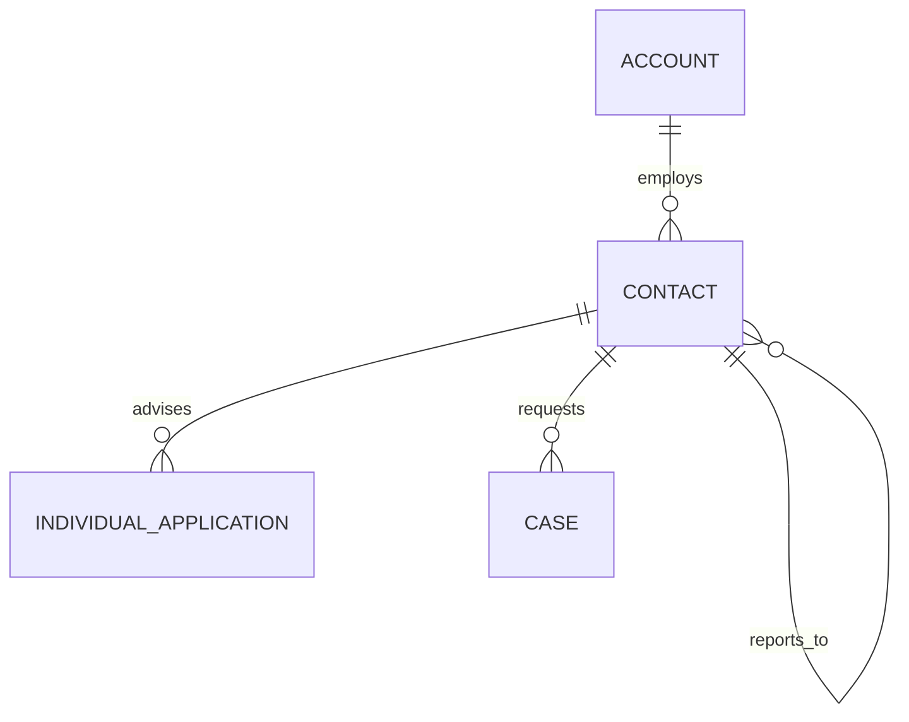

# Contact (Contact)

**Object Type**: Standard Object  
**Key Prefix**: `003`  
**Module / Cloud**: Institutional & Identity Model  
**Metadata Definition**: [force-app/main/default/objects/Contact/](file:///d:/SUNY_COMMON_DEV/SUNY_COMMON_DEV/force-app/main/default/objects/Contact/)

---

## 1. Overview & Role in SUNY

Represents individual staff members, campus faculty, academic advisors, admissions officers, and applicant references across the SUNY multi-campus network.

---

## 2. Record Types & Classification

- Standard Contact: Utilized for campus personnel, faculty, recommenders, and non-student individual constituents.

---

## 3. Key Fields Specification

| Field Label | API Name | Data Type | Reference / Target | Description |
| :--- | :--- | :--- | :--- | :--- |
| **Name** | `Name` | Text(255) | - | Full name of the contact person. |
| **AccountId** | `AccountId` | Lookup | Account | Parent SUNY campus institution or employer organization. |
| **Email** | `Email` | Email | - | Primary institutional or professional email address. |
| **Phone** | `Phone` | Phone | - | Primary telephone contact number. |
| **Title** | `Title` | Text(128) | - | Academic or professional job title (e.g., Professor, Admissions Counselor). |
| **Department** | `Department` | Text(80) | - | Academic department or operational division within the campus. |
| **ReportsToId** | `ReportsToId` | Lookup | Contact | Manager or department chair contact hierarchy reference. |

---

## 4. Entity Relationships & Data Flow



### Outbound Relationships (Parent References)
- AccountId -> [Account](file:///d:/SUNY_COMMON_DEV/SUNY_COMMON_DEV/docs/objects/Account.md) (Employing campus or institution)
- ReportsToId -> [Contact](file:///d:/SUNY_COMMON_DEV/SUNY_COMMON_DEV/docs/objects/Contact.md) (Department head or supervisor)

### Inbound Relationships (Child Records)
- IndividualApplication.ContactId -> Student applicant contact record
- ApplicationReview.ReviewerContactId -> Reviewer contact identity
- Case.ContactId -> Inquiring constituent or student support requester

---

## 5. Sample SOQL Query

```sql
SELECT Id, Name, Account.Name, Email, Title, Department FROM Contact ORDER BY Name LIMIT 10
```

---

[Return to Master Object Schema Overview](file:///d:/SUNY_COMMON_DEV/SUNY_COMMON_DEV/docs/object_schema.md)
