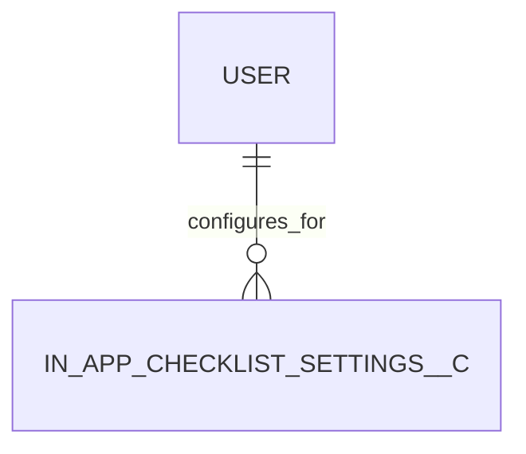

# In-App Checklist Settings (In_App_Checklist_Settings__c)

**Object Type**: Custom Setting (Hierarchy / List)  
**Key Prefix**: `a00`  
**Module / Cloud**: Core CRM & Support Operations  
**Metadata Definition**: [force-app/main/default/objects/In_App_Checklist_Settings__c/](file:///d:/SUNY_COMMON_DEV/SUNY_COMMON_DEV/force-app/main/default/objects/In_App_Checklist_Settings__c/)

---

## 1. Overview & Role in SUNY

Custom setting configuring student in-app onboarding checklists, campus guidance prompts, and task completion trackers in student portals.

---

## 2. Record Types & Classification

- Custom Setting: Hierarchical or list custom setting configuring portal behaviors.

---

## 3. Key Fields Specification

| Field Label | API Name | Data Type | Reference / Target | Description |
| :--- | :--- | :--- | :--- | :--- |
| **Name** | `Name` | Text(80) | - | Configuration setting record name. |
| **SetupOwnerId** | `SetupOwnerId` | Lookup | User / Profile / Org | Hierarchy level determining setting inheritance. |
| **Checklist_Active__c** | `Checklist_Active__c` | Checkbox | - | Global toggle enabling or disabling in-app checklist widgets. |
| **Max_Tasks_Displayed__c** | `Max_Tasks_Displayed__c` | Number(3,0) | - | Maximum number of incomplete onboarding tasks shown in UI. |
| **Portal_Route__c** | `Portal_Route__c` | Text(255) | - | Target URL or component route where checklist widget is embedded. |

---

## 4. Entity Relationships & Data Flow



### Outbound Relationships (Parent References)
- SetupOwnerId -> Target Profile, User, or Organization defining configuration level

### Inbound Relationships (Child Records)
- StudentPortalUI -> In-App Guidance components rendering student onboarding checklist

---

## 5. Sample SOQL Query

```sql
SELECT Id, Name, SetupOwnerId FROM In_App_Checklist_Settings__c LIMIT 10
```

---

[Return to Master Object Schema Overview](file:///d:/SUNY_COMMON_DEV/SUNY_COMMON_DEV/docs/object_schema.md)
