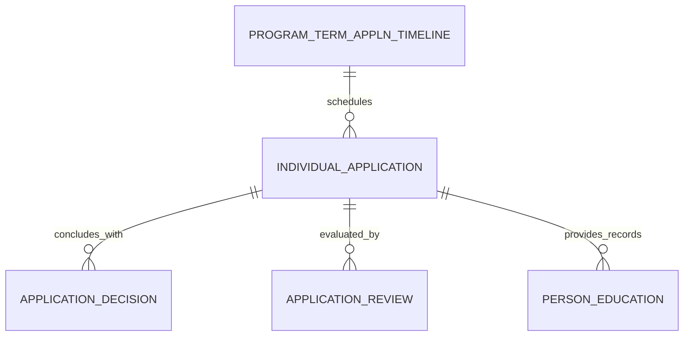

# Individual Application (IndividualApplication)

**Object Type**: Standard Education Cloud Object  
**Key Prefix**: `14J`  
**Module / Cloud**: Admissions & Recruitment  
**Metadata Definition**: [force-app/main/default/objects/IndividualApplication/](file:///d:/SUNY_COMMON_DEV/SUNY_COMMON_DEV/force-app/main/default/objects/IndividualApplication/)

---

## 1. Overview & Role in SUNY

The central record for an application submitted by a student for admission into a specific SUNY academic program, degree plan, or course in a designated term.

---

## 2. Record Types & Classification

- Undergraduate: First-time freshman and four-year degree applications.
- Transfer: Articulation and transfer credit admissions applications.
- Graduate: Advanced master's, doctoral, and post-baccalaureate applications.

---

## 3. Key Fields Specification

| Field Label | API Name | Data Type | Reference / Target | Description |
| :--- | :--- | :--- | :--- | :--- |
| **Name** | `Name` | Text(255) | - | Application tracking number or descriptive label. |
| **AccountId** | `AccountId` | Lookup | Account | Student Person Account submitting the application. |
| **ContactId** | `ContactId` | Lookup | Contact | Student Contact record associated with the application. |
| **ProgramTermApplnTimelineId** | `ProgramTermApplnTimelineId` | Lookup | ProgramTermApplnTimeline | Specific program intake window and term deadline. |
| **ApplicationCaseId** | `ApplicationCaseId` | Lookup | Case | Admissions processing case associated with this application. |
| **OpportunityId** | `OpportunityId` | Lookup | Opportunity | Associated financial or enrollment pipeline opportunity. |
| **Status** | `Status` | Picklist | - | Current status (Draft, Submitted, Under Review, Decision Rendered). |

---

## 4. Entity Relationships & Data Flow



### Outbound Relationships (Parent References)
- AccountId -> [Account](file:///d:/SUNY_COMMON_DEV/SUNY_COMMON_DEV/docs/objects/Account.md) (Learner Person Account)
- ContactId -> [Contact](file:///d:/SUNY_COMMON_DEV/SUNY_COMMON_DEV/docs/objects/Contact.md) (Applicant Contact)
- ProgramTermApplnTimelineId -> [ProgramTermApplnTimeline](file:///d:/SUNY_COMMON_DEV/SUNY_COMMON_DEV/docs/objects/ProgramTermApplnTimeline.md) (Target intake term)

### Inbound Relationships (Child Records)
- ApplicationDecision.ApplicationId -> Official admissions decisions rendered
- ApplicationReview.ApplicationId -> Faculty and staff scoring reviews
- PersonEducation.IndividualApplicationId -> Educational history records attached to application
- PersonExamination.IndividualApplicationId -> Test scores attached to application

---

## 5. Sample SOQL Query

```sql
SELECT Id, Name, Account.Name, Status, ProgramTermApplnTimeline.Name FROM IndividualApplication LIMIT 10
```

---

[Return to Master Object Schema Overview](file:///d:/SUNY_COMMON_DEV/SUNY_COMMON_DEV/docs/object_schema.md)
