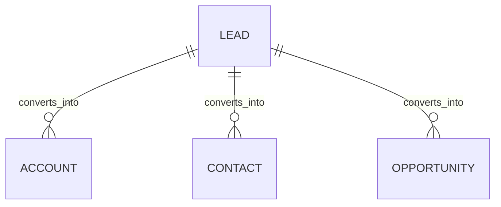

# Lead (Lead)

**Object Type**: Standard Object  
**Key Prefix**: `00Q`  
**Module / Cloud**: Core CRM & Support Operations  
**Metadata Definition**: [force-app/main/default/objects/Lead/](file:///d:/SUNY_COMMON_DEV/SUNY_COMMON_DEV/force-app/main/default/objects/Lead/)

---

## 1. Overview & Role in SUNY

Tracks prospective student inquiries, college fair recruitment leads, campus tour sign-ups, and pre-application pipeline engagement.

---

## 2. Record Types & Classification

- Undergraduate Prospect: High school inquiries and college fair attendees.
- Graduate Prospect: Inquiries into advanced master's and doctoral degrees.

---

## 3. Key Fields Specification

| Field Label | API Name | Data Type | Reference / Target | Description |
| :--- | :--- | :--- | :--- | :--- |
| **Name** | `Name` | Text(255) | - | Full name of prospective student lead. |
| **Company** | `Company` | Text(255) | - | Current high school or prior college attended (standard Lead requirement). |
| **Email** | `Email` | Email | - | Primary communication email address. |
| **Phone** | `Phone` | Phone | - | Primary phone number. |
| **Status** | `Status` | Picklist | - | Lead qualification status (Open, Contacted, Qualified, Unqualified). |
| **LeadSource** | `LeadSource` | Picklist | - | Inquiry acquisition channel (College Fair, Web Form, Campus Visit). |
| **ConvertedAccountId** | `ConvertedAccountId` | Lookup | Account | Account created upon qualifying and converting lead. |

---

## 4. Entity Relationships & Data Flow



### Outbound Relationships (Parent References)
- ConvertedAccountId -> [Account](file:///d:/SUNY_COMMON_DEV/SUNY_COMMON_DEV/docs/objects/Account.md) (Converted Person Account)
- ConvertedContactId -> [Contact](file:///d:/SUNY_COMMON_DEV/SUNY_COMMON_DEV/docs/objects/Contact.md) (Converted Contact)

### Inbound Relationships (Child Records)
- CampaignMember -> Recruitment outreach events and prospective student campaigns

---

## 5. Sample SOQL Query

```sql
SELECT Id, Name, Email, Status, LeadSource, Company FROM Lead ORDER BY CreatedDate DESC LIMIT 10
```

---

[Return to Master Object Schema Overview](file:///d:/SUNY_COMMON_DEV/SUNY_COMMON_DEV/docs/object_schema.md)
