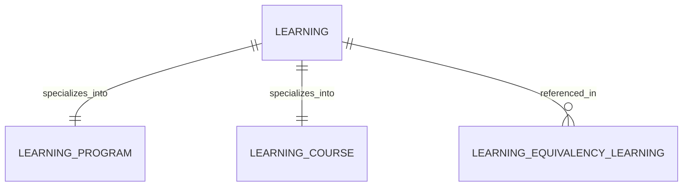

# Learning (Learning)

**Object Type**: Standard Education Cloud Object  
**Key Prefix**: `0LN`  
**Module / Cloud**: Curriculum & Learning Model  
**Metadata Definition**: [force-app/main/default/objects/Learning/](file:///d:/SUNY_COMMON_DEV/SUNY_COMMON_DEV/force-app/main/default/objects/Learning/)

---

## 1. Overview & Role in SUNY

Base abstract catalog object representing any instructional unit or educational offering before specialization into courses or programs.

---

## 2. Record Types & Classification

- Standard Learning: Fundamental root record for courses, programs, and modules.

---

## 3. Key Fields Specification

| Field Label | API Name | Data Type | Reference / Target | Description |
| :--- | :--- | :--- | :--- | :--- |
| **Name** | `Name` | Text(255) | - | Official name of the learning unit. |
| **LearningType** | `LearningType` | Picklist | - | Classification (Course, Program, Module, Milestone). |
| **Status** | `Status` | Picklist | - | Catalog lifecycle state (Draft, Active, Archived). |
| **Description** | `Description` | LongTextArea | - | Comprehensive academic description of learning objectives. |
| **IsActive** | `IsActive` | Checkbox | - | Flag indicating whether this learning entity is currently active. |

---

## 4. Entity Relationships & Data Flow



### Outbound Relationships (Parent References)
- None (Root abstract curriculum entity)

### Inbound Relationships (Child Records)
- LearningProgram.LearningId -> Program specialization of this learning entity
- LearningCourse.LearningId -> Course specialization of this learning entity
- LearningEquivalencyLearning.LearningId -> Transfer credit articulation mapping

---

## 5. Sample SOQL Query

```sql
SELECT Id, Name, LearningType, Status, IsActive FROM Learning LIMIT 10
```

---

[Return to Master Object Schema Overview](file:///d:/SUNY_COMMON_DEV/SUNY_COMMON_DEV/docs/object_schema.md)
