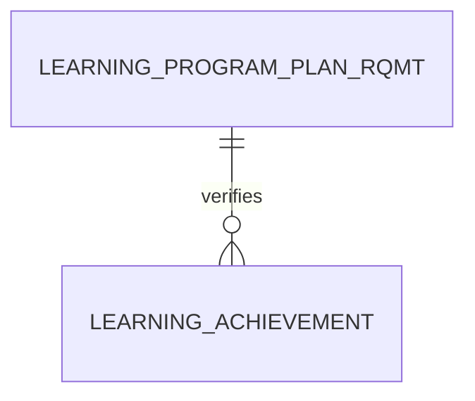

# Learning Achievement (LearningAchievement)

**Object Type**: Standard Education Cloud Object  
**Key Prefix**: `0LA`  
**Module / Cloud**: Curriculum & Learning Model  
**Metadata Definition**: [force-app/main/default/objects/LearningAchievement/](file:///d:/SUNY_COMMON_DEV/SUNY_COMMON_DEV/force-app/main/default/objects/LearningAchievement/)

---

## 1. Overview & Role in SUNY

Represents milestones, honors, competencies, or certifications earned by learners as they fulfill program requirements across SUNY.

---

## 2. Record Types & Classification

- Competency: Verified student mastery of a specific skill or learning outcome.
- Honor: Dean's List or Latin honors designation awarded to student.

---

## 3. Key Fields Specification

| Field Label | API Name | Data Type | Reference / Target | Description |
| :--- | :--- | :--- | :--- | :--- |
| **Name** | `Name` | Text(255) | - | Achievement title (e.g., Python Data Analytics Competency, Dean's Honors). |
| **AchievementType** | `AchievementType` | Picklist | - | Type (Competency, Honor, Milestone, Digital Badge). |
| **Category** | `Category` | Picklist | - | Academic or professional domain category. |
| **Level** | `Level` | Picklist | - | Proficiency level (Foundational, Intermediate, Advanced). |
| **Status** | `Status` | Picklist | - | State of achievement (Active, Archived). |
| **Description** | `Description` | Text(255) | - | Criteria and documentation verifying achievement completion. |

---

## 4. Entity Relationships & Data Flow



### Outbound Relationships (Parent References)
- None (Curriculum achievement catalog entity)

### Inbound Relationships (Child Records)
- PersonAcademicCredential -> Linked credential records documenting student achievement

---

## 5. Sample SOQL Query

```sql
SELECT Id, Name, AchievementType, Category, Level, Status FROM LearningAchievement LIMIT 10
```

---

[Return to Master Object Schema Overview](file:///d:/SUNY_COMMON_DEV/SUNY_COMMON_DEV/docs/object_schema.md)
