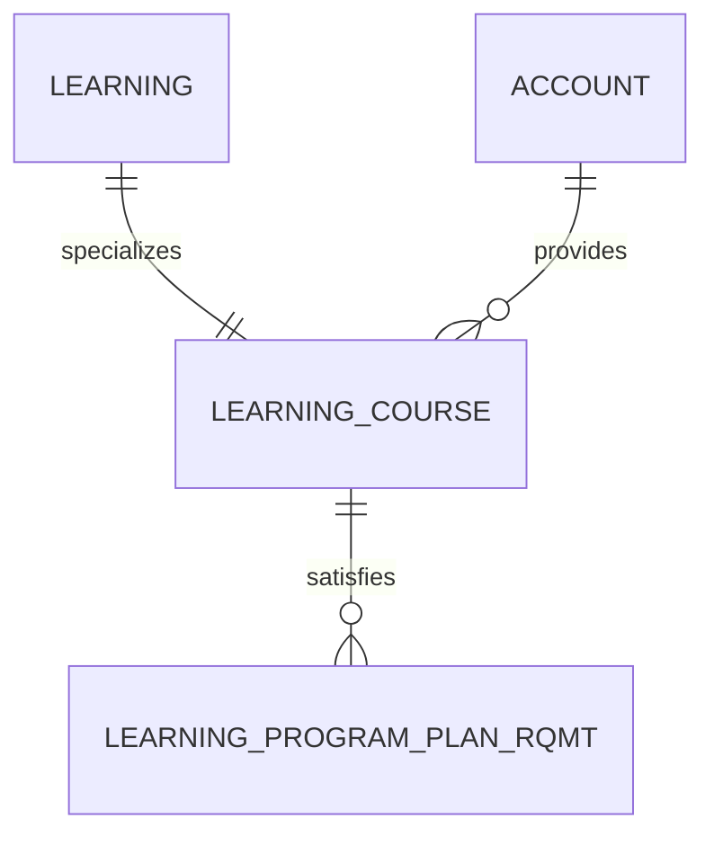

# Learning Course (LearningCourse)

**Object Type**: Standard Education Cloud Object  
**Key Prefix**: `0LC`  
**Module / Cloud**: Curriculum & Learning Model  
**Metadata Definition**: [force-app/main/default/objects/LearningCourse/](file:///d:/SUNY_COMMON_DEV/SUNY_COMMON_DEV/force-app/main/default/objects/LearningCourse/)

---

## 1. Overview & Role in SUNY

Represents an individual catalog course offered by a SUNY campus (e.g., BIO 101 - General Biology, CS 250 - Data Structures).

---

## 2. Record Types & Classification

- Lecture: Standard lecture instruction format.
- Lab / Studio: Laboratory, studio, or practicum hands-on coursework.

---

## 3. Key Fields Specification

| Field Label | API Name | Data Type | Reference / Target | Description |
| :--- | :--- | :--- | :--- | :--- |
| **Name** | `Name` | Text(255) | - | Course title (e.g., Introduction to Computer Science). |
| **LearningId** | `LearningId` | Lookup | Learning | Parent abstract learning record for catalog consistency. |
| **ProviderId** | `ProviderId` | Lookup | Account | SUNY campus offering this course. |
| **CourseCode** | `CourseCode` | Text(32) | - | Campus course subject and number (e.g. CSE 114, BIO 101). |
| **SubjectArea** | `SubjectArea` | Picklist | - | Academic discipline (Computer Science, Biology, Mathematics). |
| **CreditHours** | `CreditHours` | Number(4,2) | - | Academic credits awarded upon successful completion. |
| **Description** | `Description` | LongTextArea | - | Detailed catalog description and course syllabus outline. |

---

## 4. Entity Relationships & Data Flow



### Outbound Relationships (Parent References)
- LearningId -> [Learning](file:///d:/SUNY_COMMON_DEV/SUNY_COMMON_DEV/docs/objects/Learning.md) (Abstract learning parent)
- ProviderId -> [Account](file:///d:/SUNY_COMMON_DEV/SUNY_COMMON_DEV/docs/objects/Account.md) (Campus offering this course)

### Inbound Relationships (Child Records)
- LearningProgramPlanRqmt.LearningCourseId -> Degree requirement course rules
- LearningPathwayTemplateItem.LearningCourseId -> Recommended roadmap semester scheduling
- LearningEquivalencyLearning.CourseId -> Transfer articulation equivalency pairings

---

## 5. Sample SOQL Query

```sql
SELECT Id, Name, CourseCode, SubjectArea, CreditHours, Provider.Name FROM LearningCourse LIMIT 10
```

---

[Return to Master Object Schema Overview](file:///d:/SUNY_COMMON_DEV/SUNY_COMMON_DEV/docs/object_schema.md)
