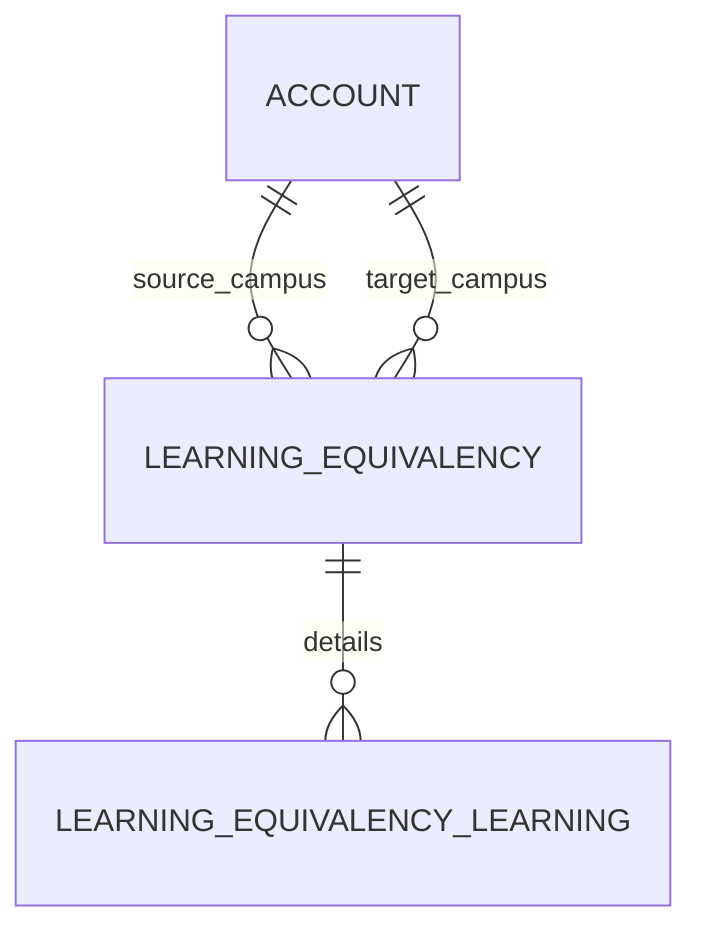

# Learning Equivalency (LearningEquivalency)

**Object Type**: Standard Education Cloud Object  
**Key Prefix**: `0LE`  
**Module / Cloud**: Curriculum & Learning Model  
**Metadata Definition**: [force-app/main/default/objects/LearningEquivalency/](file:///d:/SUNY_COMMON_DEV/SUNY_COMMON_DEV/force-app/main/default/objects/LearningEquivalency/)

---

## 1. Overview & Role in SUNY

Establishes articulation agreements and transfer credit equivalency rules between external college courses and SUNY campus courses.

---

## 2. Record Types & Classification

- Course-to-Course: Direct single course transfer equivalence rule.
- Block Transfer: Comprehensive general education or associate degree transfer waiver.

---

## 3. Key Fields Specification

| Field Label | API Name | Data Type | Reference / Target | Description |
| :--- | :--- | :--- | :--- | :--- |
| **Name** | `Name` | Text(255) | - | Equivalency agreement identifier (e.g., MCC to UB Biology Articulation). |
| **SourceInstitutionId** | `SourceInstitutionId` | Lookup | Account | Sending external institution or community college. |
| **TargetInstitutionId** | `TargetInstitutionId` | Lookup | Account | Receiving SUNY college or university campus. |
| **EffectiveDate** | `EffectiveDate` | Date | - | Date on which articulation agreement becomes valid. |
| **ExpirationDate** | `ExpirationDate` | Date | - | Expiration date of transfer agreement rule. |
| **Status** | `Status` | Picklist | - | Status of articulation agreement (Active, Under Review, Expired). |

---

## 4. Entity Relationships & Data Flow



### Outbound Relationships (Parent References)
- SourceInstitutionId -> [Account](file:///d:/SUNY_COMMON_DEV/SUNY_COMMON_DEV/docs/objects/Account.md) (Sending institution)
- TargetInstitutionId -> [Account](file:///d:/SUNY_COMMON_DEV/SUNY_COMMON_DEV/docs/objects/Account.md) (Receiving SUNY campus)

### Inbound Relationships (Child Records)
- LearningEquivalencyLearning.LearningEquivalencyId -> Specific course mapping rules under agreement

---

## 5. Sample SOQL Query

```sql
SELECT Id, Name, SourceInstitution.Name, TargetInstitution.Name, Status, EffectiveDate FROM LearningEquivalency LIMIT 10
```

---

[Return to Master Object Schema Overview](file:///d:/SUNY_COMMON_DEV/SUNY_COMMON_DEV/docs/object_schema.md)
