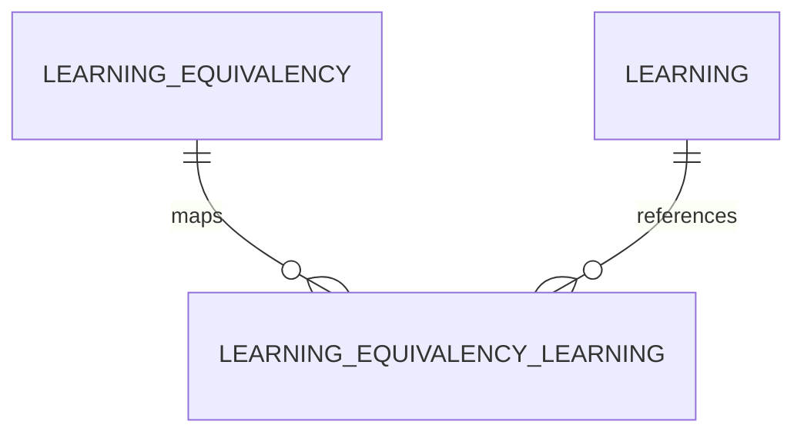

# Learning Equivalency Learning (LearningEquivalencyLearning)

**Object Type**: Standard Education Cloud Object  
**Key Prefix**: `0LL`  
**Module / Cloud**: Curriculum & Learning Model  
**Metadata Definition**: [force-app/main/default/objects/LearningEquivalencyLearning/](file:///d:/SUNY_COMMON_DEV/SUNY_COMMON_DEV/force-app/main/default/objects/LearningEquivalencyLearning/)

---

## 1. Overview & Role in SUNY

Junction object connecting specific source course/learning items to their equivalent destination course/learning items within an equivalency agreement.

---

## 2. Record Types & Classification

- Source Learning: Course taken at transferring institution.
- Destination Learning: Course credited at receiving SUNY institution.

---

## 3. Key Fields Specification

| Field Label | API Name | Data Type | Reference / Target | Description |
| :--- | :--- | :--- | :--- | :--- |
| **Name** | `Name` | Text(255) | - | Equivalency learning line item reference identifier. |
| **LearningEquivalencyId** | `LearningEquivalencyId` | Lookup | LearningEquivalency | Parent articulation agreement. |
| **LearningId** | `LearningId` | Lookup | Learning | Mapped course or learning item. |
| **CourseRole** | `CourseRole` | Picklist | - | Role of course in articulation (Source Course, Equivalent Course). |
| **MinimumGradeRequired** | `MinimumGradeRequired` | Picklist | - | Minimum grade required for transfer credit (e.g. C or better). |
| **CreditsGranted** | `CreditsGranted` | Number(4,2) | - | Number of semester credits granted at receiving campus. |

---

## 4. Entity Relationships & Data Flow



### Outbound Relationships (Parent References)
- LearningEquivalencyId -> [LearningEquivalency](file:///d:/SUNY_COMMON_DEV/SUNY_COMMON_DEV/docs/objects/LearningEquivalency.md) (Parent agreement)
- LearningId -> [Learning](file:///d:/SUNY_COMMON_DEV/SUNY_COMMON_DEV/docs/objects/Learning.md) (Mapped course)

### Inbound Relationships (Child Records)
- TransferCreditEvaluation -> Automated credit articulation processing for incoming transcripts

---

## 5. Sample SOQL Query

```sql
SELECT Id, Name, LearningEquivalency.Name, Learning.Name, CourseRole, CreditsGranted FROM LearningEquivalencyLearning LIMIT 10
```

---

[Return to Master Object Schema Overview](file:///d:/SUNY_COMMON_DEV/SUNY_COMMON_DEV/docs/object_schema.md)
