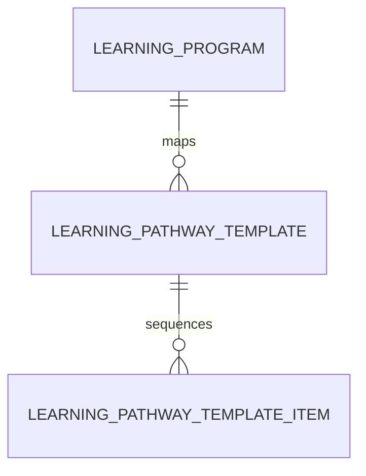

# Learning Pathway Template (LearningPathwayTemplate)

**Object Type**: Standard Education Cloud Object  
**Key Prefix**: `0PT`  
**Module / Cloud**: Curriculum & Learning Model  
**Metadata Definition**: [force-app/main/default/objects/LearningPathwayTemplate/](file:///d:/SUNY_COMMON_DEV/SUNY_COMMON_DEV/force-app/main/default/objects/LearningPathwayTemplate/)

---

## 1. Overview & Role in SUNY

Provides a pre-configured multi-semester course sequence template or academic roadmap to guide students toward timely degree completion.

---

## 2. Record Types & Classification

- 4-Year Standard: Traditional eight-semester undergraduate completion pathway.
- 2-Year Transfer: Accelerated completion track for Associate degree transfer students.

---

## 3. Key Fields Specification

| Field Label | API Name | Data Type | Reference / Target | Description |
| :--- | :--- | :--- | :--- | :--- |
| **Name** | `Name` | Text(255) | - | Template title (e.g., Biology BS - 4 Year Graduation Roadmap). |
| **LearningProgramId** | `LearningProgramId` | Lookup | LearningProgram | Degree program structured by this pathway template. |
| **TotalSemesters** | `TotalSemesters` | Number(2,0) | - | Total recommended semesters in the completion sequence (typically 4 or 8). |
| **Status** | `Status` | Picklist | - | Operational state (Draft, Active, Deprecated). |
| **Description** | `Description` | Text(255) | - | Student advising guidance and milestone progression notes. |

---

## 4. Entity Relationships & Data Flow



### Outbound Relationships (Parent References)
- LearningProgramId -> [LearningProgram](file:///d:/SUNY_COMMON_DEV/SUNY_COMMON_DEV/docs/objects/LearningProgram.md) (Structured degree program)

### Inbound Relationships (Child Records)
- LearningPathwayTemplateItem.LearningPathwayTemplateId -> Individual course sequence items across semesters

---

## 5. Sample SOQL Query

```sql
SELECT Id, Name, LearningProgram.Name, TotalSemesters, Status FROM LearningPathwayTemplate LIMIT 10
```

---

[Return to Master Object Schema Overview](file:///d:/SUNY_COMMON_DEV/SUNY_COMMON_DEV/docs/object_schema.md)
