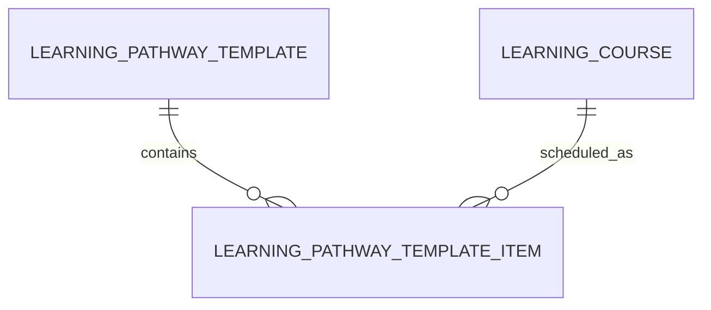

# Learning Pathway Template Item (LearningPathwayTemplateItem)

**Object Type**: Standard Education Cloud Object  
**Key Prefix**: `0PI`  
**Module / Cloud**: Curriculum & Learning Model  
**Metadata Definition**: [force-app/main/default/objects/LearningPathwayTemplateItem/](file:///d:/SUNY_COMMON_DEV/SUNY_COMMON_DEV/force-app/main/default/objects/LearningPathwayTemplateItem/)

---

## 1. Overview & Role in SUNY

Represents an individual scheduled milestone, recommended course, or requirement block within a semester of a pathway template.

---

## 2. Record Types & Classification

- Recommended Course: Specific course recommended for registration in designated semester.
- Elective Placeholder: Generic elective credit placeholder recommendation.

---

## 3. Key Fields Specification

| Field Label | API Name | Data Type | Reference / Target | Description |
| :--- | :--- | :--- | :--- | :--- |
| **Name** | `Name` | Text(255) | - | Item description (e.g., Semester 1 - Calculus I). |
| **LearningPathwayTemplateId** | `LearningPathwayTemplateId` | Lookup | LearningPathwayTemplate | Parent pathway template. |
| **RecommendedSemester** | `RecommendedSemester` | Number(2,0) | - | Recommended academic semester sequence number (1 through 8). |
| **LearningCourseId** | `LearningCourseId` | Lookup | LearningCourse | Specific course recommended for enrollment. |
| **RequirementGroupId** | `RequirementGroupId` | Lookup | LearningProgramPlanRqmt | Associated requirement fulfilled by item. |
| **Sequence** | `Sequence` | Number(3,0) | - | Display order of the course item within the semester schedule. |

---

## 4. Entity Relationships & Data Flow



### Outbound Relationships (Parent References)
- LearningPathwayTemplateId -> [LearningPathwayTemplate](file:///d:/SUNY_COMMON_DEV/SUNY_COMMON_DEV/docs/objects/LearningPathwayTemplate.md) (Parent template)
- LearningCourseId -> [LearningCourse](file:///d:/SUNY_COMMON_DEV/SUNY_COMMON_DEV/docs/objects/LearningCourse.md) (Recommended course)

### Inbound Relationships (Child Records)
- DegreeAuditSchedule -> Semester course recommendation generation for student advising

---

## 5. Sample SOQL Query

```sql
SELECT Id, Name, LearningPathwayTemplate.Name, RecommendedSemester, LearningCourse.Name, Sequence FROM LearningPathwayTemplateItem LIMIT 10
```

---

[Return to Master Object Schema Overview](file:///d:/SUNY_COMMON_DEV/SUNY_COMMON_DEV/docs/object_schema.md)
