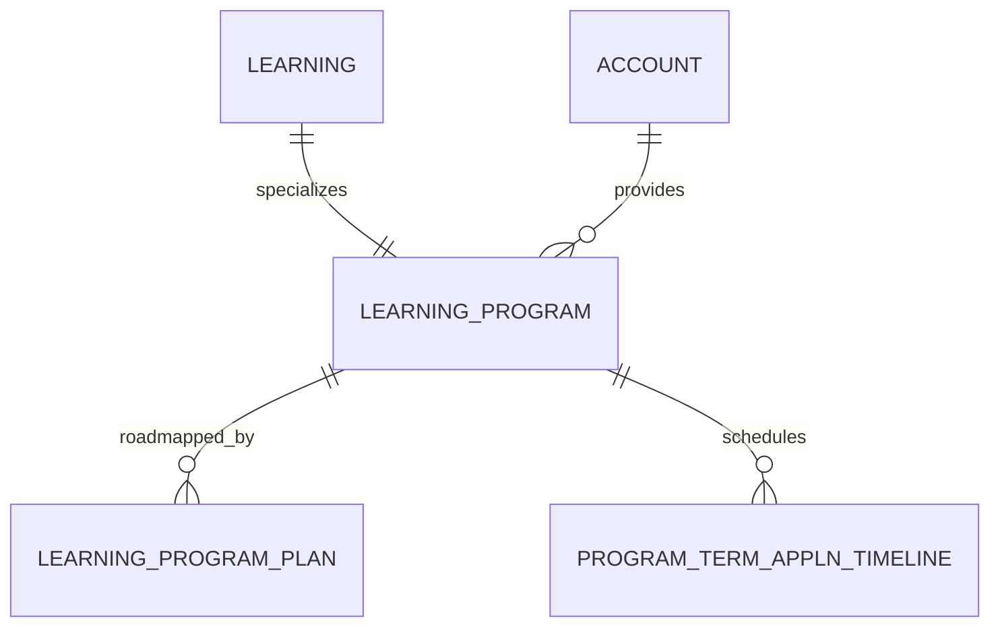

# Learning Program (LearningProgram)

**Object Type**: Standard Education Cloud Object  
**Key Prefix**: `0LP`  
**Module / Cloud**: Curriculum & Learning Model  
**Metadata Definition**: [force-app/main/default/objects/LearningProgram/](file:///d:/SUNY_COMMON_DEV/SUNY_COMMON_DEV/force-app/main/default/objects/LearningProgram/)

---

## 1. Overview & Role in SUNY

Represents an official academic program of study leading to a degree or certificate (e.g., B.S. in Computer Science) at a SUNY campus.

---

## 2. Record Types & Classification

- Major: Primary undergraduate or graduate degree program.
- Minor: Secondary academic concentration or minor.

---

## 3. Key Fields Specification

| Field Label | API Name | Data Type | Reference / Target | Description |
| :--- | :--- | :--- | :--- | :--- |
| **Name** | `Name` | Text(255) | - | Program title (e.g., Bachelor of Science in Mechanical Engineering). |
| **LearningId** | `LearningId` | Lookup | Learning | Parent abstract learning record. |
| **ProviderId** | `ProviderId` | Lookup | Account | SUNY campus awarding the degree. |
| **AcademicCredentialId** | `AcademicCredentialId` | Lookup | AcademicCredential | Credential awarded upon graduation. |
| **ProgramCode** | `ProgramCode` | Text(32) | - | Official campus program code or CIP identifier. |
| **Status** | `Status` | Picklist | - | Program state (Active, Pending Review, Phasing Out). |
| **TotalCreditsRequired** | `TotalCreditsRequired` | Number(5,2) | - | Minimum credit hours required to earn the degree. |

---

## 4. Entity Relationships & Data Flow



### Outbound Relationships (Parent References)
- LearningId -> [Learning](file:///d:/SUNY_COMMON_DEV/SUNY_COMMON_DEV/docs/objects/Learning.md) (Abstract learning parent)
- ProviderId -> [Account](file:///d:/SUNY_COMMON_DEV/SUNY_COMMON_DEV/docs/objects/Account.md) (Campus providing the program)
- AcademicCredentialId -> [AcademicCredential](file:///d:/SUNY_COMMON_DEV/SUNY_COMMON_DEV/docs/objects/AcademicCredential.md) (Conferred degree type)

### Inbound Relationships (Child Records)
- LearningProgramPlan.LearningProgramId -> Specific catalog year curriculum plans
- ProgramTermApplnTimeline.LearningProgramId -> Intake application deadlines for this program
- LearningPathwayTemplate.LearningProgramId -> Recommended completion roadmap templates

---

## 5. Sample SOQL Query

```sql
SELECT Id, Name, ProgramCode, Provider.Name, AcademicCredential.Name, Status FROM LearningProgram LIMIT 10
```

---

[Return to Master Object Schema Overview](file:///d:/SUNY_COMMON_DEV/SUNY_COMMON_DEV/docs/object_schema.md)
