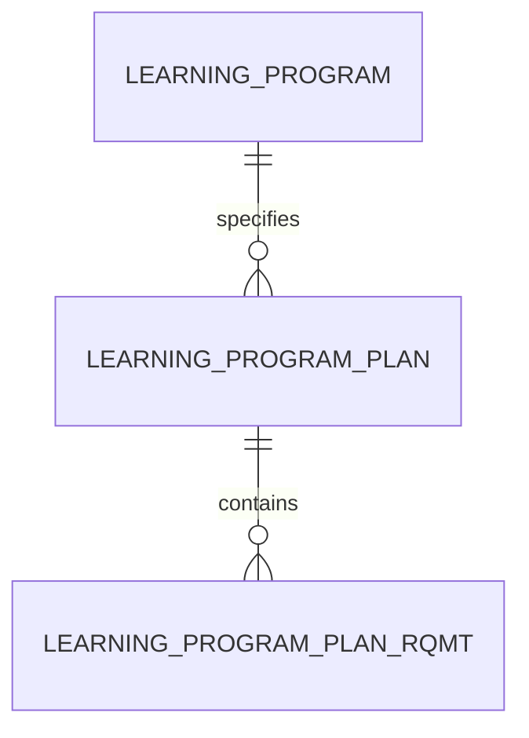

# Learning Program Plan (LearningProgramPlan)

**Object Type**: Standard Education Cloud Object  
**Key Prefix**: `0PP`  
**Module / Cloud**: Curriculum & Learning Model  
**Metadata Definition**: [force-app/main/default/objects/LearningProgramPlan/](file:///d:/SUNY_COMMON_DEV/SUNY_COMMON_DEV/force-app/main/default/objects/LearningProgramPlan/)

---

## 1. Overview & Role in SUNY

Defines a specific catalog year or curriculum roadmap version for completing a SUNY Learning Program (e.g., Computer Science Catalog 2026-2027).

---

## 2. Record Types & Classification

- Standard Program Plan: Versioned curriculum requirements for student cohorts.

---

## 3. Key Fields Specification

| Field Label | API Name | Data Type | Reference / Target | Description |
| :--- | :--- | :--- | :--- | :--- |
| **Name** | `Name` | Text(255) | - | Plan label (e.g., Computer Science BS - 2026 Catalog). |
| **LearningProgramId** | `LearningProgramId` | Lookup | LearningProgram | Parent degree program governed by this plan. |
| **EffectiveYear** | `EffectiveYear` | Text(16) | - | Catalog academic year when this requirement structure takes effect. |
| **Status** | `Status` | Picklist | - | Lifecycle status (Draft, Active, Superceded). |
| **TotalRequiredCredits** | `TotalRequiredCredits` | Number(5,2) | - | Total semester credits required by this plan version. |
| **Description** | `Description` | Text(255) | - | Overview of curriculum updates and graduation policies. |

---

## 4. Entity Relationships & Data Flow



### Outbound Relationships (Parent References)
- LearningProgramId -> [LearningProgram](file:///d:/SUNY_COMMON_DEV/SUNY_COMMON_DEV/docs/objects/LearningProgram.md) (Parent academic program)

### Inbound Relationships (Child Records)
- LearningProgramPlanRqmt.LearningProgramPlanId -> Specific course groups and credit rules for graduation

---

## 5. Sample SOQL Query

```sql
SELECT Id, Name, LearningProgram.Name, EffectiveYear, Status, TotalRequiredCredits FROM LearningProgramPlan LIMIT 10
```

---

[Return to Master Object Schema Overview](file:///d:/SUNY_COMMON_DEV/SUNY_COMMON_DEV/docs/object_schema.md)
