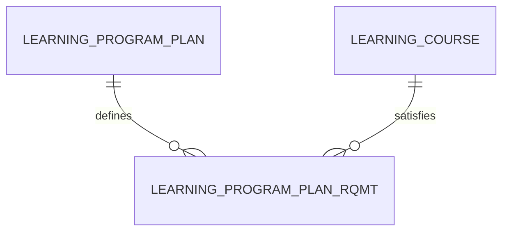

# Learning Program Plan Requirement (LearningProgramPlanRqmt)

**Object Type**: Standard Education Cloud Object  
**Key Prefix**: `0PR`  
**Module / Cloud**: Curriculum & Learning Model  
**Metadata Definition**: [force-app/main/default/objects/LearningProgramPlanRqmt/](file:///d:/SUNY_COMMON_DEV/SUNY_COMMON_DEV/force-app/main/default/objects/LearningProgramPlanRqmt/)

---

## 1. Overview & Role in SUNY

Specifies a specific graduation requirement, core course rule, or elective credit group within a curriculum roadmap.

---

## 2. Record Types & Classification

- Core Course: Mandatory individual course required for graduation.
- Elective Group: Category pool requiring a minimum number of elective credits.

---

## 3. Key Fields Specification

| Field Label | API Name | Data Type | Reference / Target | Description |
| :--- | :--- | :--- | :--- | :--- |
| **Name** | `Name` | Text(255) | - | Requirement name (e.g., General Chemistry Core, Upper-Level CS Electives). |
| **LearningProgramPlanId** | `LearningProgramPlanId` | Lookup | LearningProgramPlan | Parent curriculum plan containing this rule. |
| **ParentRequirementId** | `ParentRequirementId` | Lookup | LearningProgramPlanRqmt | Parent grouping requirement for nested hierarchies. |
| **RequirementType** | `RequirementType` | Picklist | - | Classification (Core, General Education, Major Elective, Capstone). |
| **CreditsRequired** | `CreditsRequired` | Number(4,2) | - | Number of credits necessary to fulfill this specific requirement. |
| **LearningCourseId** | `LearningCourseId` | Lookup | LearningCourse | Specific course satisfying requirement if directly mapped. |

---

## 4. Entity Relationships & Data Flow



### Outbound Relationships (Parent References)
- LearningProgramPlanId -> [LearningProgramPlan](file:///d:/SUNY_COMMON_DEV/SUNY_COMMON_DEV/docs/objects/LearningProgramPlan.md) (Parent program plan)
- ParentRequirementId -> [LearningProgramPlanRqmt](file:///d:/SUNY_COMMON_DEV/SUNY_COMMON_DEV/docs/objects/LearningProgramPlanRqmt.md) (Parent requirement rule)
- LearningCourseId -> [LearningCourse](file:///d:/SUNY_COMMON_DEV/SUNY_COMMON_DEV/docs/objects/LearningCourse.md) (Direct course requirement)

### Inbound Relationships (Child Records)
- LearningAchievement -> Milestone or honor granted upon fulfilling this requirement

---

## 5. Sample SOQL Query

```sql
SELECT Id, Name, LearningProgramPlan.Name, RequirementType, CreditsRequired FROM LearningProgramPlanRqmt LIMIT 10
```

---

[Return to Master Object Schema Overview](file:///d:/SUNY_COMMON_DEV/SUNY_COMMON_DEV/docs/object_schema.md)
