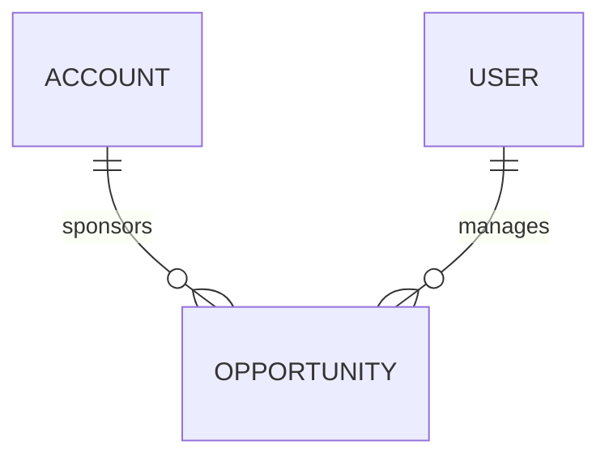

# Opportunity (Opportunity)

**Object Type**: Standard Object  
**Key Prefix**: `006`  
**Module / Cloud**: Core CRM & Support Operations  
**Metadata Definition**: [force-app/main/default/objects/Opportunity/](file:///d:/SUNY_COMMON_DEV/SUNY_COMMON_DEV/force-app/main/default/objects/Opportunity/)

---

## 1. Overview & Role in SUNY

Tracks institutional grants, corporate recruitment sponsorships, donor gifts, and prospective student enrollment conversion pipelines.

---

## 2. Record Types & Classification

- Institutional Partnership: Corporate employer partnerships and sponsorships.
- Donor Contribution: Alumni and philanthropic endowment gifts.
- Enrollment Opportunity: Tuition pipeline tracking for specialized cohort programs.

---

## 3. Key Fields Specification

| Field Label | API Name | Data Type | Reference / Target | Description |
| :--- | :--- | :--- | :--- | :--- |
| **Name** | `Name` | Text(120) | - | Opportunity deal or grant name. |
| **AccountId** | `AccountId` | Lookup | Account | Associated employer, donor, or institutional account. |
| **StageName** | `StageName` | Picklist | - | Pipeline stage (Prospecting, Proposal Sent, Negotiation, Closed Won). |
| **Amount** | `Amount` | Currency(18,2) | - | Financial value of grant, pledge, or projected tuition. |
| **CloseDate** | `CloseDate` | Date | - | Projected or actual award commitment date. |
| **Probability** | `Probability` | Percent(3,0) | - | Estimated likelihood of winning partnership or grant. |
| **Type** | `Type` | Picklist | - | Classification (Grant, Corporate Partnership, Philanthropy). |

---

## 4. Entity Relationships & Data Flow



### Outbound Relationships (Parent References)
- AccountId -> [Account](file:///d:/SUNY_COMMON_DEV/SUNY_COMMON_DEV/docs/objects/Account.md) (Associated partner or donor account)

### Inbound Relationships (Child Records)
- IndividualApplication.OpportunityId -> Connected financial aid or tuition pipeline records

---

## 5. Sample SOQL Query

```sql
SELECT Id, Name, Account.Name, StageName, Amount, CloseDate FROM Opportunity ORDER BY CloseDate DESC LIMIT 10
```

---

[Return to Master Object Schema Overview](file:///d:/SUNY_COMMON_DEV/SUNY_COMMON_DEV/docs/object_schema.md)
