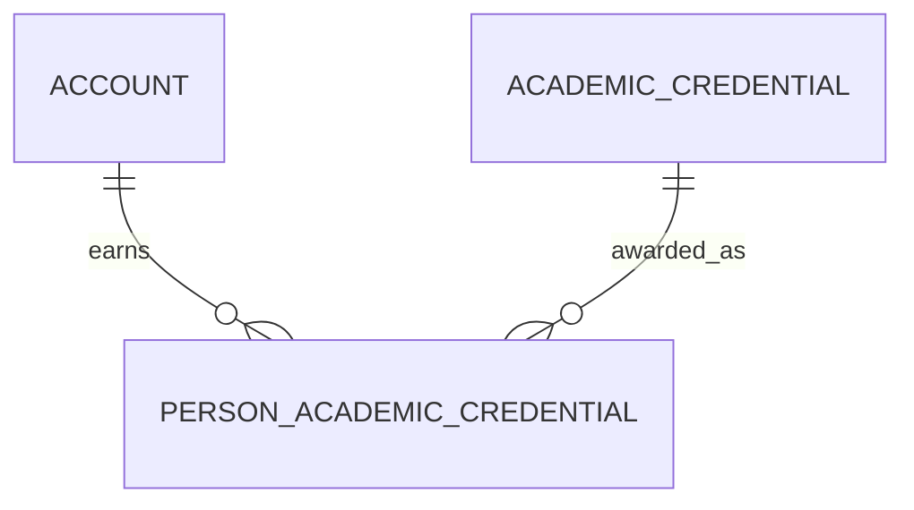

# Person Academic Credential (PersonAcademicCredential)

**Object Type**: Standard Education Cloud Object  
**Key Prefix**: `0PC`  
**Module / Cloud**: Learner 360 & Personal History  
**Metadata Definition**: [force-app/main/default/objects/PersonAcademicCredential/](file:///d:/SUNY_COMMON_DEV/SUNY_COMMON_DEV/force-app/main/default/objects/PersonAcademicCredential/)

---

## 1. Overview & Role in SUNY

Connects an individual student to the formal academic degrees, diplomas, certificates, or digital credentials they have earned.

---

## 2. Record Types & Classification

- Conferred Degree: Fully conferred academic degree earned by student upon graduation.
- Awarded Certificate: Academic or professional certificate awarded to learner.

---

## 3. Key Fields Specification

| Field Label | API Name | Data Type | Reference / Target | Description |
| :--- | :--- | :--- | :--- | :--- |
| **Name** | `Name` | Text(255) | - | Conferral record label. |
| **AccountId** | `AccountId` | Lookup | Account | Student Person Account who earned the credential. |
| **AcademicCredentialId** | `AcademicCredentialId` | Lookup | AcademicCredential | Credential definition awarded to student. |
| **ConferralDate** | `ConferralDate` | Date | - | Official date of graduation and credential conferral. |
| **Honors** | `Honors` | Picklist | - | Latin graduation honors (Cum Laude, Magna Cum Laude, Summa Cum Laude). |
| **Status** | `Status` | Picklist | - | Award status (Awarded, Revoked, Pending Final Audit). |

---

## 4. Entity Relationships & Data Flow



### Outbound Relationships (Parent References)
- AccountId -> [Account](file:///d:/SUNY_COMMON_DEV/SUNY_COMMON_DEV/docs/objects/Account.md) (Learner Person Account)
- AcademicCredentialId -> [AcademicCredential](file:///d:/SUNY_COMMON_DEV/SUNY_COMMON_DEV/docs/objects/AcademicCredential.md) (Credential awarded)

### Inbound Relationships (Child Records)
- AlumniAffairs -> Constituent alumni tracking and degree verification workflows

---

## 5. Sample SOQL Query

```sql
SELECT Id, Name, Account.Name, AcademicCredential.Name, ConferralDate, Status FROM PersonAcademicCredential LIMIT 10
```

---

[Return to Master Object Schema Overview](file:///d:/SUNY_COMMON_DEV/SUNY_COMMON_DEV/docs/object_schema.md)
