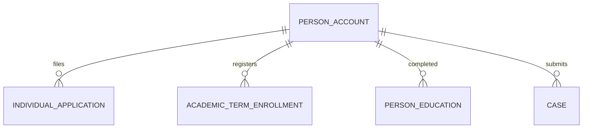

# Person Account (PersonAccount)

**Object Type**: Specialized Architecture (Account + Contact)  
**Key Prefix**: `001`  
**Module / Cloud**: Learner 360 & Personal History  
**Metadata Definition**: [force-app/main/default/objects/PersonAccount/](file:///d:/SUNY_COMMON_DEV/SUNY_COMMON_DEV/force-app/main/default/objects/PersonAccount/)

---

## 1. Overview & Role in SUNY

Person Accounts combine Account and Contact into a unified learner profile in SUNY Education Cloud. Each Person Account record represents a distinct student or applicant across their entire academic lifecycle.

---

## 2. Record Types & Classification

- PersonAccount: The standard Education Cloud record type representing student constituents.

---

## 3. Key Fields Specification

| Field Label | API Name | Data Type | Reference / Target | Description |
| :--- | :--- | :--- | :--- | :--- |
| **Name** | `Name` | Text(255) | - | Full name of the student constituent. |
| **PersonEmail** | `PersonEmail` | Email | - | Personal primary email address used for admissions and student portal communications. |
| **PersonBirthdate** | `PersonBirthdate` | Date | - | Date of birth for student identity verification and institutional records. |
| **PersonMobilePhone** | `PersonMobilePhone` | Phone | - | Primary mobile telephone number for SMS notifications and contact. |
| **PersonMailingAddress** | `PersonMailingAddress` | Address | - | Official home residential address of the student. |
| **IsPersonAccount** | `IsPersonAccount` | Checkbox | - | System flag set to TRUE identifying this record as a Person Account. |

---

## 4. Entity Relationships & Data Flow



### Outbound Relationships (Parent References)
- ParentId -> [Account](file:///d:/SUNY_COMMON_DEV/SUNY_COMMON_DEV/docs/objects/Account.md) (Primary home campus or academic system)

### Inbound Relationships (Child Records)
- IndividualApplication.AccountId -> Applications submitted by this learner
- AcademicTermEnrollment.AccountId -> Term enrollment records for this student
- PersonEducation.AccountId -> Educational history records for this student
- PersonEmployment.AccountId -> Work experience history records for this student

---

## 5. Sample SOQL Query

```sql
SELECT Id, Name, PersonEmail, PersonBirthdate, IsPersonAccount FROM Account WHERE IsPersonAccount = TRUE LIMIT 10
```

---

[Return to Master Object Schema Overview](file:///d:/SUNY_COMMON_DEV/SUNY_COMMON_DEV/docs/object_schema.md)
