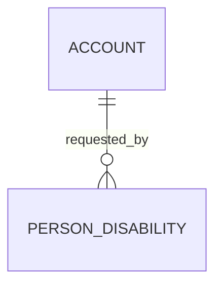

# Person Disability (PersonDisability)

**Object Type**: Standard Education Cloud Object  
**Key Prefix**: `0PD`  
**Module / Cloud**: Learner 360 & Personal History  
**Metadata Definition**: [force-app/main/default/objects/PersonDisability/](file:///d:/SUNY_COMMON_DEV/SUNY_COMMON_DEV/force-app/main/default/objects/PersonDisability/)

---

## 1. Overview & Role in SUNY

Securely tracks accessibility accommodation requests, documented learning needs, and support plans for campus accessibility service offices.

---

## 2. Record Types & Classification

- Standard Accommodation: Secure records for campus accessibility services.

---

## 3. Key Fields Specification

| Field Label | API Name | Data Type | Reference / Target | Description |
| :--- | :--- | :--- | :--- | :--- |
| **Name** | `Name` | Text(255) | - | Accommodation tracking identifier. |
| **AccountId** | `AccountId` | Lookup | Account | Student Person Account requesting or receiving accommodations. |
| **AccommodationType** | `AccommodationType` | Picklist | - | Category (Extended Exam Time, Note-taking, Mobility, Assistive Tech). |
| **Status** | `Status` | Picklist | - | Plan status (Active, In Review, Inactive, Expired). |
| **EffectiveDate** | `EffectiveDate` | Date | - | Date on which accommodation services commence. |
| **ReviewDate** | `ReviewDate` | Date | - | Scheduled date for annual accommodation plan re-evaluation. |

---

## 4. Entity Relationships & Data Flow



### Outbound Relationships (Parent References)
- AccountId -> [Account](file:///d:/SUNY_COMMON_DEV/SUNY_COMMON_DEV/docs/objects/Account.md) (Learner Person Account)

### Inbound Relationships (Child Records)
- AccessibilityServices -> Faculty notification and testing center accommodation scheduling

---

## 5. Sample SOQL Query

```sql
SELECT Id, Name, Account.Name, AccommodationType, Status, EffectiveDate FROM PersonDisability LIMIT 10
```

---

[Return to Master Object Schema Overview](file:///d:/SUNY_COMMON_DEV/SUNY_COMMON_DEV/docs/object_schema.md)
