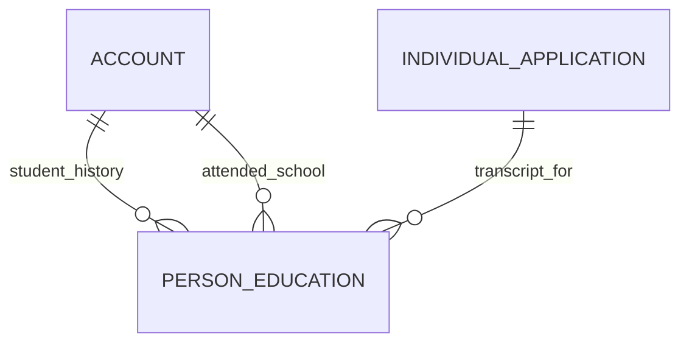

# Person Education (PersonEducation)

**Object Type**: Standard Education Cloud Object  
**Key Prefix**: `0PE`  
**Module / Cloud**: Learner 360 & Personal History  
**Metadata Definition**: [force-app/main/default/objects/PersonEducation/](file:///d:/SUNY_COMMON_DEV/SUNY_COMMON_DEV/force-app/main/default/objects/PersonEducation/)

---

## 1. Overview & Role in SUNY

Tracks a learner's educational background, including prior high schools, community colleges, and universities attended, with GPA and graduation details.

---

## 2. Record Types & Classification

- High School: Secondary education institution attended by student.
- College / University: Prior post-secondary institution attended by transfer student.

---

## 3. Key Fields Specification

| Field Label | API Name | Data Type | Reference / Target | Description |
| :--- | :--- | :--- | :--- | :--- |
| **Name** | `Name` | Text(255) | - | Education background record identifier. |
| **AccountId** | `AccountId` | Lookup | Account | Student Person Account who attended the institution. |
| **InstitutionAccountId** | `InstitutionAccountId` | Lookup | Account | Prior school or college Account record. |
| **IndividualApplicationId** | `IndividualApplicationId` | Lookup | IndividualApplication | Associated application submitted by candidate. |
| **DegreeAwarded** | `DegreeAwarded` | Picklist | - | Prior degree completed (High School Diploma, Associate, Bachelor). |
| **CumulativeGpa** | `CumulativeGpa` | Number(3,2) | - | Cumulative GPA earned at prior educational institution. |
| **GraduationDate** | `GraduationDate` | Date | - | Date on which prior degree or diploma was conferred. |

---

## 4. Entity Relationships & Data Flow



### Outbound Relationships (Parent References)
- AccountId -> [Account](file:///d:/SUNY_COMMON_DEV/SUNY_COMMON_DEV/docs/objects/Account.md) (Learner Person Account)
- InstitutionAccountId -> [Account](file:///d:/SUNY_COMMON_DEV/SUNY_COMMON_DEV/docs/objects/Account.md) (Prior school attended)
- IndividualApplicationId -> [IndividualApplication](file:///d:/SUNY_COMMON_DEV/SUNY_COMMON_DEV/docs/objects/IndividualApplication.md) (Associated application)

### Inbound Relationships (Child Records)
- TransferCreditEvaluation -> Transcript evaluation and prior credit calculation

---

## 5. Sample SOQL Query

```sql
SELECT Id, Name, Account.Name, InstitutionAccount.Name, DegreeAwarded, CumulativeGpa FROM PersonEducation LIMIT 10
```

---

[Return to Master Object Schema Overview](file:///d:/SUNY_COMMON_DEV/SUNY_COMMON_DEV/docs/object_schema.md)
