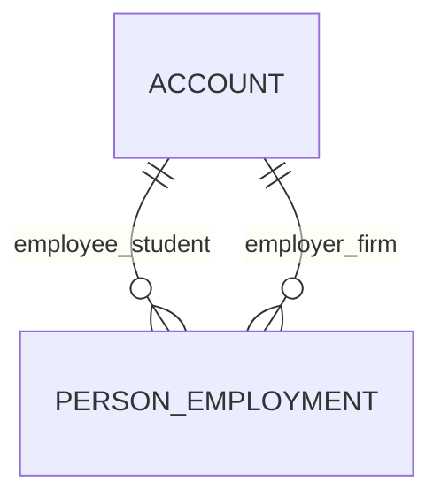

# Person Employment (PersonEmployment)

**Object Type**: Standard Education Cloud Object  
**Key Prefix**: `0EM`  
**Module / Cloud**: Learner 360 & Personal History  
**Metadata Definition**: [force-app/main/default/objects/PersonEmployment/](file:///d:/SUNY_COMMON_DEV/SUNY_COMMON_DEV/force-app/main/default/objects/PersonEmployment/)

---

## 1. Overview & Role in SUNY

Captures work history, military service, cooperative education, and professional experience for applicants and enrolled students across SUNY.

---

## 2. Record Types & Classification

- Professional Employment: Full-time or part-time industry employment.
- Military Service: Armed forces service history and veteran status verification.

---

## 3. Key Fields Specification

| Field Label | API Name | Data Type | Reference / Target | Description |
| :--- | :--- | :--- | :--- | :--- |
| **Name** | `Name` | Text(255) | - | Employment experience record title. |
| **AccountId** | `AccountId` | Lookup | Account | Student Person Account holding the employment position. |
| **EmployerAccountId** | `EmployerAccountId` | Lookup | Account | Employer company or organization Account record. |
| **PositionTitle** | `PositionTitle` | Text(128) | - | Job title or position held (e.g., Software Intern, Research Assistant). |
| **StartDate** | `StartDate` | Date | - | Employment start date. |
| **EndDate** | `EndDate` | Date | - | Employment conclusion date. |
| **IsCurrent** | `IsCurrent` | Checkbox | - | Indicates whether the student is currently employed in this position. |

---

## 4. Entity Relationships & Data Flow



### Outbound Relationships (Parent References)
- AccountId -> [Account](file:///d:/SUNY_COMMON_DEV/SUNY_COMMON_DEV/docs/objects/Account.md) (Learner Person Account)
- EmployerAccountId -> [Account](file:///d:/SUNY_COMMON_DEV/SUNY_COMMON_DEV/docs/objects/Account.md) (Employer organization)

### Inbound Relationships (Child Records)
- CareerServices -> Experiential learning and internship credit placement verification

---

## 5. Sample SOQL Query

```sql
SELECT Id, Name, Account.Name, EmployerAccount.Name, PositionTitle, StartDate, IsCurrent FROM PersonEmployment LIMIT 10
```

---

[Return to Master Object Schema Overview](file:///d:/SUNY_COMMON_DEV/SUNY_COMMON_DEV/docs/object_schema.md)
