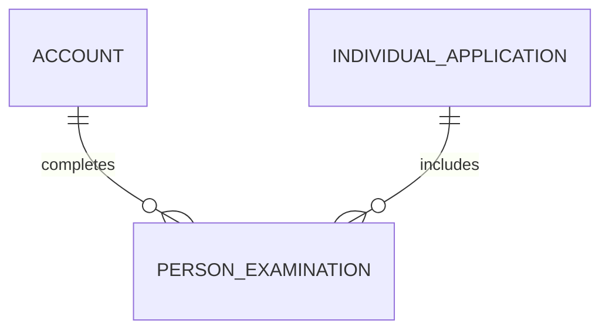

# Person Examination (PersonExamination)

**Object Type**: Standard Education Cloud Object  
**Key Prefix**: `0EX`  
**Module / Cloud**: Learner 360 & Personal History  
**Metadata Definition**: [force-app/main/default/objects/PersonExamination/](file:///d:/SUNY_COMMON_DEV/SUNY_COMMON_DEV/force-app/main/default/objects/PersonExamination/)

---

## 1. Overview & Role in SUNY

Stores standardized test scores (SAT, ACT, GRE, TOEFL, IELTS, AP) submitted by applicants for admissions evaluation and course placement.

---

## 2. Record Types & Classification

- Admissions Exam: SAT, ACT, GRE, GMAT standardized tests.
- Language Proficiency: TOEFL, IELTS, Duolingo English test scores.
- Credit by Exam: Advanced Placement (AP) and International Baccalaureate (IB) scores.

---

## 3. Key Fields Specification

| Field Label | API Name | Data Type | Reference / Target | Description |
| :--- | :--- | :--- | :--- | :--- |
| **Name** | `Name` | Text(255) | - | Examination record identifier label. |
| **AccountId** | `AccountId` | Lookup | Account | Student Person Account who completed the exam. |
| **IndividualApplicationId** | `IndividualApplicationId` | Lookup | IndividualApplication | Application submitting this exam score. |
| **ExaminationType** | `ExaminationType` | Picklist | - | Exam classification (SAT, ACT, GRE, TOEFL, AP). |
| **OfficialScore** | `OfficialScore` | Text(32) | - | Official composite or scaled score reported by testing agency. |
| **ExamDate** | `ExamDate` | Date | - | Date on which the student took the examination. |
| **Status** | `Status` | Picklist | - | Score verification status (Self-Reported, Official Verified, Expired). |

---

## 4. Entity Relationships & Data Flow



### Outbound Relationships (Parent References)
- AccountId -> [Account](file:///d:/SUNY_COMMON_DEV/SUNY_COMMON_DEV/docs/objects/Account.md) (Learner Person Account)
- IndividualApplicationId -> [IndividualApplication](file:///d:/SUNY_COMMON_DEV/SUNY_COMMON_DEV/docs/objects/IndividualApplication.md) (Associated application)

### Inbound Relationships (Child Records)
- AdmissionsPlacement -> Automatic math and language course placement determinations

---

## 5. Sample SOQL Query

```sql
SELECT Id, Name, Account.Name, ExaminationType, OfficialScore, ExamDate, Status FROM PersonExamination LIMIT 10
```

---

[Return to Master Object Schema Overview](file:///d:/SUNY_COMMON_DEV/SUNY_COMMON_DEV/docs/object_schema.md)
