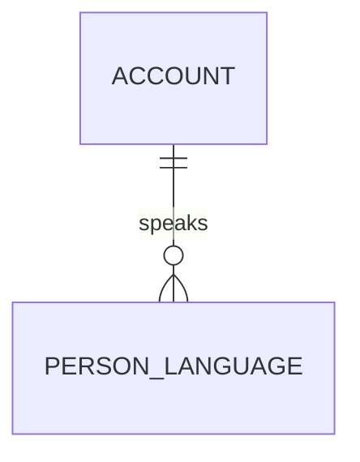

# Person Language (PersonLanguage)

**Object Type**: Standard Education Cloud Object  
**Key Prefix**: `0PL`  
**Module / Cloud**: Learner 360 & Personal History  
**Metadata Definition**: [force-app/main/default/objects/PersonLanguage/](file:///d:/SUNY_COMMON_DEV/SUNY_COMMON_DEV/force-app/main/default/objects/PersonLanguage/)

---

## 1. Overview & Role in SUNY

Records language proficiencies, native languages, and bilingual capabilities for students and applicants across SUNY campuses.

---

## 2. Record Types & Classification

- Standard Language: Documents student language proficiencies and multilingual abilities.

---

## 3. Key Fields Specification

| Field Label | API Name | Data Type | Reference / Target | Description |
| :--- | :--- | :--- | :--- | :--- |
| **Name** | `Name` | Text(255) | - | Language proficiency record identifier. |
| **AccountId** | `AccountId` | Lookup | Account | Student Person Account possessing language ability. |
| **Language** | `Language` | Picklist | - | Spoken/written language (English, Spanish, Mandarin, French, etc.). |
| **SpeakingProficiency** | `SpeakingProficiency` | Picklist | - | Proficiency rating (Native, Fluent, Professional, Basic). |
| **ReadingProficiency** | `ReadingProficiency` | Picklist | - | Reading comprehension level. |
| **WritingProficiency** | `WritingProficiency` | Picklist | - | Written composition proficiency. |
| **IsPrimaryLanguage** | `IsPrimaryLanguage` | Checkbox | - | Indicates whether this is the student's primary native language. |

---

## 4. Entity Relationships & Data Flow



### Outbound Relationships (Parent References)
- AccountId -> [Account](file:///d:/SUNY_COMMON_DEV/SUNY_COMMON_DEV/docs/objects/Account.md) (Learner Person Account)

### Inbound Relationships (Child Records)
- InternationalStudentServices -> ESL advising and translation accommodation support

---

## 5. Sample SOQL Query

```sql
SELECT Id, Name, Account.Name, Language, SpeakingProficiency, IsPrimaryLanguage FROM PersonLanguage LIMIT 10
```

---

[Return to Master Object Schema Overview](file:///d:/SUNY_COMMON_DEV/SUNY_COMMON_DEV/docs/object_schema.md)
