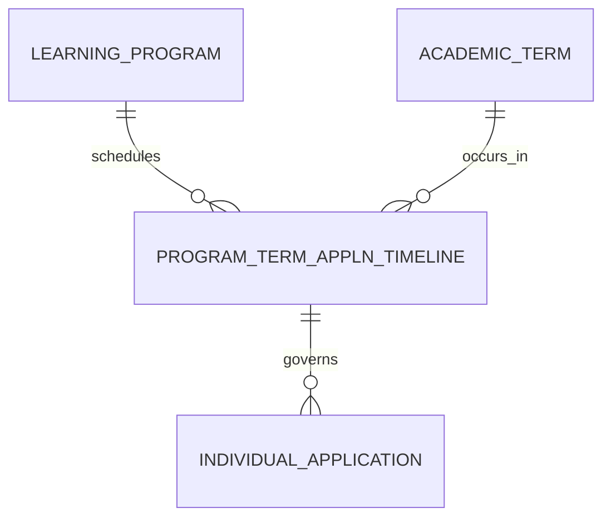

# Program Term Application Timeline (ProgramTermApplnTimeline)

**Object Type**: Standard Education Cloud Object  
**Key Prefix**: `14P`  
**Module / Cloud**: Admissions & Recruitment  
**Metadata Definition**: [force-app/main/default/objects/ProgramTermApplnTimeline/](file:///d:/SUNY_COMMON_DEV/SUNY_COMMON_DEV/force-app/main/default/objects/ProgramTermApplnTimeline/)

---

## 1. Overview & Role in SUNY

Defines open application submission windows, priority filing dates, and decision release deadlines for a specific program in an academic term across SUNY campuses.

---

## 2. Record Types & Classification

- Standard Timeline: Governs admissions cycles for domestic and international cohorts.

---

## 3. Key Fields Specification

| Field Label | API Name | Data Type | Reference / Target | Description |
| :--- | :--- | :--- | :--- | :--- |
| **Name** | `Name` | Text(255) | - | Timeline label (e.g. Fall 2026 CS Undergrad Regular Decision). |
| **LearningProgramId** | `LearningProgramId` | Lookup | LearningProgram | Target degree or certificate program for this admissions cycle. |
| **AcademicTermId** | `AcademicTermId` | Lookup | AcademicTerm | Target academic term of enrollment. |
| **ApplicationOpenDate** | `ApplicationOpenDate` | Date | - | First date on which applications are accepted for this intake. |
| **ApplicationDueDate** | `ApplicationDueDate` | Date | - | Final deadline date for application submission. |
| **DecisionReleaseDate** | `DecisionReleaseDate` | Date | - | Official date on which admissions decisions are communicated. |

---

## 4. Entity Relationships & Data Flow



### Outbound Relationships (Parent References)
- LearningProgramId -> [LearningProgram](file:///d:/SUNY_COMMON_DEV/SUNY_COMMON_DEV/docs/objects/LearningProgram.md) (Target degree program)
- AcademicTermId -> [AcademicTerm](file:///d:/SUNY_COMMON_DEV/SUNY_COMMON_DEV/docs/objects/AcademicTerm.md) (Target academic semester)

### Inbound Relationships (Child Records)
- IndividualApplication.ProgramTermApplnTimelineId -> Applications filed against this admissions timeline window

---

## 5. Sample SOQL Query

```sql
SELECT Id, Name, LearningProgram.Name, AcademicTerm.Name, ApplicationOpenDate, ApplicationDueDate FROM ProgramTermApplnTimeline LIMIT 10
```

---

[Return to Master Object Schema Overview](file:///d:/SUNY_COMMON_DEV/SUNY_COMMON_DEV/docs/object_schema.md)
