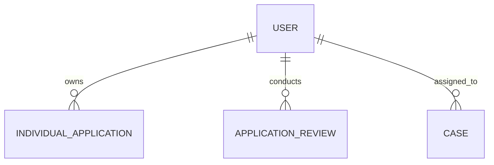

# User (User)

**Object Type**: Standard Object  
**Key Prefix**: `005`  
**Module / Cloud**: System Administration & Access Control  
**Metadata Definition**: [force-app/main/default/objects/User/](file:///d:/SUNY_COMMON_DEV/SUNY_COMMON_DEV/force-app/main/default/objects/User/)

---

## 1. Overview & Role in SUNY

Represents authenticated internal staff, admissions evaluators, faculty advisors, system administrators, and applicant community portal users.

---

## 2. Record Types & Classification

- Internal User: Campus employees, admissions evaluators, and system administrators.
- Customer / Community User: External applicants and prospective learners accessing the SUNY admissions portal.

---

## 3. Key Fields Specification

| Field Label | API Name | Data Type | Reference / Target | Description |
| :--- | :--- | :--- | :--- | :--- |
| **Username** | `Username` | Text(80) | - | Unique system login username formatted as an email address. |
| **Email** | `Email` | Email | - | Primary communication email address for system notifications. |
| **ProfileId** | `ProfileId` | Lookup | Profile | Security profile defining object-level and field-level permissions. |
| **UserRoleId** | `UserRoleId` | Lookup | UserRole | Role hierarchy node controlling data visibility and sharing rules. |
| **IsActive** | `IsActive` | Checkbox | - | Indicates whether the user account is active and permitted to authenticate. |
| **UserType** | `UserType` | Picklist | - | Classification of user license (Standard, PowerPartner, CSN, Guest). |
| **ContactId** | `ContactId` | Lookup | Contact | Associated Contact record for community and portal identity. |

---

## 4. Entity Relationships & Data Flow



### Outbound Relationships (Parent References)
- ContactId -> [Contact](file:///d:/SUNY_COMMON_DEV/SUNY_COMMON_DEV/docs/objects/Contact.md) (Community user linked contact record)

### Inbound Relationships (Child Records)
- IndividualApplication.OwnerId -> Assigned admissions counselor
- ApplicationReview.ReviewerId -> Faculty or staff reviewer conducting evaluation
- Case.OwnerId -> Staff member handling student service ticket

---

## 5. Sample SOQL Query

```sql
SELECT Id, Username, Email, Profile.Name, IsActive, UserType FROM User WHERE IsActive = TRUE LIMIT 10
```

---

[Return to Master Object Schema Overview](file:///d:/SUNY_COMMON_DEV/SUNY_COMMON_DEV/docs/object_schema.md)
